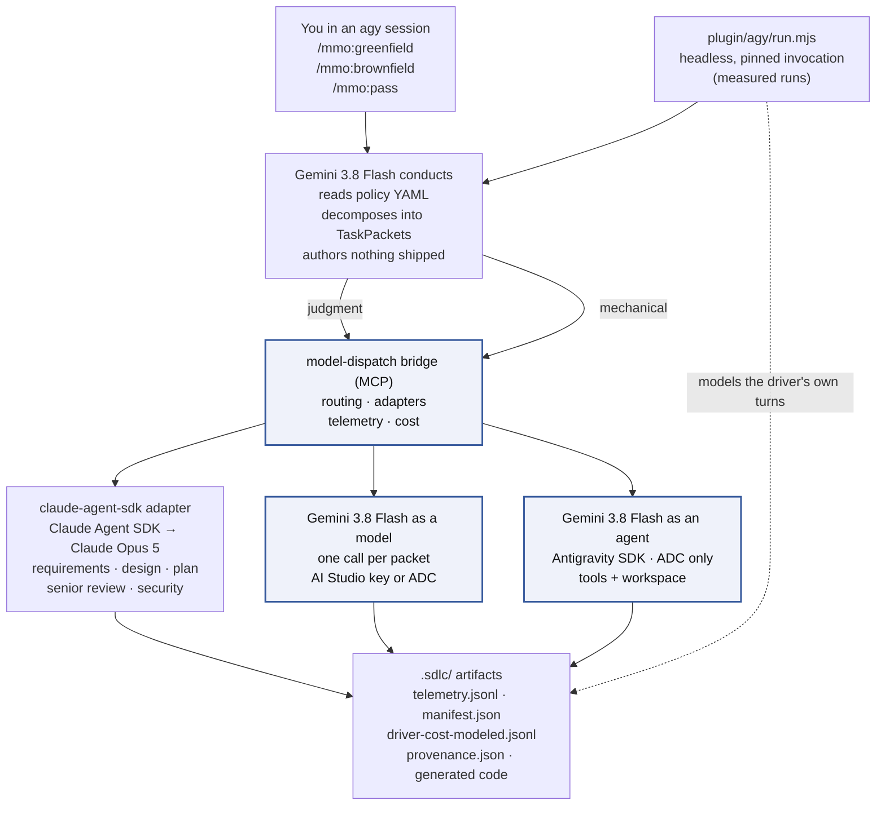
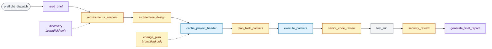
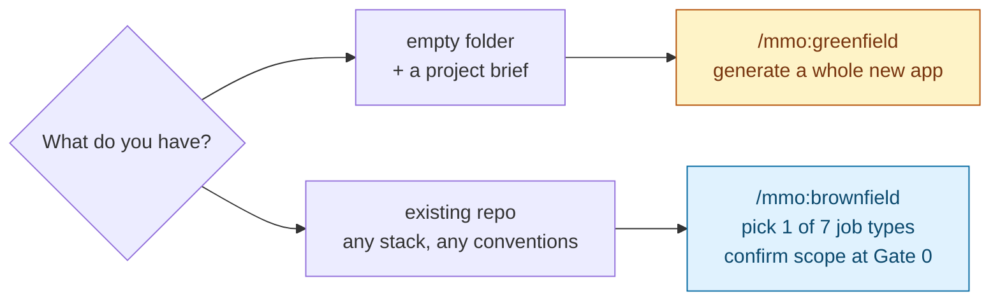

# AI-SDLC Orchestrator — Antigravity Harness

[](LICENSE)
[](https://github.com/tl-ai-labs/ai-sdlc-orchestrator-antigravity-harness/actions/workflows/test.yml)
[](plugin/plugin.json)


## What this is

An Antigravity CLI (`agy`) plugin that runs a full SDLC pipeline — requirements → design → code → tests → docs → senior review → security review — against either an empty folder (**greenfield**) or an existing repository (**brownfield**). It is the third runtime harness for the same `mmo` plugin and the same `model-dispatch` bridge, after the [Claude Code harness](https://github.com/tl-ai-labs/ai-sdlc-orchestrator-claude-code-harness) and the [Codex harness](https://github.com/tl-ai-labs/ai-sdlc-orchestrator-codex-harness).

The cast is fixed by policy:

| Role | Model | Path |
|---|---|---|
| Conductor (driver) | Gemini 3.8 Flash, effort high | `agy` itself, on your Google seat |
| Judgment phases | Claude Opus 5 | bridge → `claude-agent-sdk` adapter → the Claude Agent SDK (`@anthropic-ai/claude-agent-sdk`, in-process). Arm A bills an Anthropic key; arm B bills a GCP project through Vertex; a claude.ai seat is the third door |
| Mechanical phases | Gemini 3.8 Flash | bridge → `flash-completion` on `GEMINI_API_KEY`, or the Antigravity SDK worker on Vertex ADC |

The conductor authors no shipped content. Every requirements document, design, packet result, review and test comes back from a bridge dispatch, where it is priced and recorded in `telemetry.jsonl`. The conductor's own turns are priced separately and labeled **modeled**, because a Google seat has no invoice; the two kinds of dollars are never summed. See [docs/methodology.md](docs/methodology.md).

Every generated file, every telemetry event, and every cost report lands under your project directory. Nothing is uploaded off the machine.

## Architecture

### System dataflow



The highlighted path is where cost drops — mechanical work routed off Opus into the cheaper tier. Which door the mechanical tier uses (model vs agent) is picked once at setup; both reach the same model at the same published rates. Unlike the Claude Code harness, judgment work also crosses the bridge here, so the Opus line is vendor-metered rather than inferred from a session transcript.

Two routes reach the bridge. In an interactive session agy loads the plugin's `mcp_config.json` and the conductor calls the bridge's tools directly. In print mode (`agy -p`, what `run.mjs` uses) no plugin loads at all, so the conductor shells out to [plugin/agy/dispatch.mjs](plugin/agy/dispatch.mjs), which speaks MCP to the same server. Same five tools, same TaskPacket contract.

### Phase timeline

A greenfield run walks 11 states in order. Brownfield inserts two more (`discovery`, `change_plan`) around the same core. Each state is color-coded by which tier does the work.



Legend — **amber:** Claude Opus 5 through the bridge (judgment). **blue:** Gemini 3.8 Flash through the bridge (mechanical). **violet:** the conductor's own read or assembly, no dispatch — modeled, not billed. **grey:** local — no model call.

Four HITL gates fire along the way: after requirements (Gate 1), after design (Gate 2), after security review (Gate 3), before final acceptance (Gate 4). Brownfield adds Gate 0 (discovery confirmation) before any of them. Headless runs answer them with `--gates=auto-approve` and record each decision in `gates.jsonl`.

The full plugin file inventory lives in [docs/architecture.md](docs/architecture.md#file-inventory).

## What it can do

### Tasks — the seven brownfield job types

Pick one at Gate 0 in `/mmo:brownfield`.

| Job type | When to use | Who does the heavy lifting |
|---|---|---|
| `docs` | Write API docs, README, ADRs, docstrings | Gemini 3.8 Flash |
| `bugfix` | Fix a specific defect (reproduce → diagnose → fix → regression test) | Gemini 3.8 Flash · escalates to Opus 5 after 2 failed retries |
| `feature-extend` | Add a capability to an existing endpoint or module | Opus 5 for change plan · Flash for the edits |
| `feature-new` | Add a new subsystem (endpoint + storage + tests) | Opus 5 for design · Flash for full codegen mix |
| `refactor` | Extract shared logic; runs the **full** test suite for invariants | Opus 5 for refactor plan · Flash for `refactor_extract` + patches |
| `test` | Backfill tests to a coverage target | Gemini 3.8 Flash |
| `deps` | Upgrade a dependency + patch breaking-change fallout | Opus 5 for dep-swap plan · Flash for adjacent-code patches |

The playbooks the skills read are [plugin/skills/pipeline/SKILL.md](plugin/skills/pipeline/SKILL.md) and [plugin/skills/brownfield-guide/SKILL.md](plugin/skills/brownfield-guide/SKILL.md).

### Routing — model per phase

Same rule applies to greenfield and brownfield. The default `antigravity-flash38-plus-opus5` policy routes:

| Phase | Tier | Model in the default policy |
|---|---|---|
| `requirements_analysis` · `architecture_design` · `plan_task_packets` | premium | Claude Opus 5, effort high |
| `senior_code_review` · `security_review` | premium | Claude Opus 5, effort high |
| `change_plan` (brownfield only) | premium | Claude Opus 5, effort high |
| `discovery` (brownfield only) | driver | the conductor's own local read, never dispatched; logged as an `in_session` row |
| `execute_packets` (codegen) · `tests` · `docs` | mechanical | Gemini 3.8 Flash |
| `debug` (retry_count ≥ 2) | premium | Claude Opus 5 (auto-escalation) |
| `test_run` | local | Bash on your machine, no model call |
| the loop itself | driver | Gemini 3.8 Flash on agy — modeled, never dispatched |

Source: [plugin/config/policies/antigravity-flash38-plus-opus5.yaml:89](plugin/config/policies/antigravity-flash38-plus-opus5.yaml). Every rule is data — change routing by editing the YAML, or author a new policy in the browser console via `/mmo:policy change`. The top-level `driver:` block is the conductor pin; `run.mjs` asserts the invocation against it before anything is spent.

Two guardrails ship on:

- **Escalation** — a mechanical-tier packet that fails validation twice auto-routes to Opus 5 on the third attempt. Prevents infinite retries when Flash can't solve a particular puzzle.
- **Hard cost cap** — `hard_cost_cap_usd: 50` per run ([antigravity-flash38-plus-opus5.yaml:157](plugin/config/policies/antigravity-flash38-plus-opus5.yaml)). Before each `execute_with_model` call, the bridge sums `cost_usd` over the run's `telemetry.jsonl`, leaving out `tier: "orchestrator"` lines. Once that sum reaches the cap, the bridge refuses the dispatch without calling a model and returns an error naming the cap, the spend and the file. Raise or lower the cap in your own policy, or remove the key to run without one; a value that is not a positive number fails at policy load. The console shows the cap on every card and carries it into saved policies.

  What the cap does not cover:

  | Case | Why |
  |---|---|
  | The call that crosses the cap | The check runs before a call, never during it, so that call completes and the run ends above the cap by its cost. Calls already in flight also complete. |
  | A dispatch with no `telemetry_path` | The bridge has no file to count from, so it neither checks that dispatch nor counts its cost. |
  | The driver's modeled line | It lives in `driver-cost-modeled.jsonl`, not `telemetry.jsonl`, and modeled dollars are never summed with cash. |
  | A single judgment call's output | Opus 5 runs uncapped; see [docs/methodology.md](docs/methodology.md#output-ceiling-doubling). |

One policy ships:

| Policy | Uses | Cap |
|---|---|---|
| `antigravity-flash38-plus-opus5` (default) | Gemini 3.8 Flash conducts, Opus 5 judges, Flash executes — the study policy | $50 |

The Claude Code harness's `opus-*` and `flash-*` presets are not shipped here; they live under `plugin/mcp/model-dispatch/test/fixtures/policies/` as routing-engine test fixtures.

Deep dive: [docs/brownfield-routing.md](docs/brownfield-routing.md).

## Greenfield vs. brownfield



| Mode | Skill | What it does |
|---|---|---|
| **Greenfield** | `/mmo:greenfield` | Generates a whole new application from a project brief into `./src/`. Original flow the plugin was built for. |
| **Brownfield** | `/mmo:brownfield` | Extends an existing repository. Pick one of the seven job types above, confirm scope at Gate 0, run the pipeline with a non-destructive write contract that guarantees off-limits files stay untouched. |

Both use the same install, same policies, same bridge. `/mmo:greenfield` in an existing repo warns you and offers `/mmo:brownfield` instead.

Brownfield reference:

- [docs/brownfield.md](docs/brownfield.md) — overview + Gate 0 walkthrough
- [docs/brownfield-write-contract.md](docs/brownfield-write-contract.md) — how the write contract enforces "never touch off-limits"
- [docs/brownfield-coexistence.md](docs/brownfield-coexistence.md) — coexistence with Cursor, Aider, Copilot, custom MCP
- [docs/brownfield-privacy.md](docs/brownfield-privacy.md) — data flow, private endpoints, regulated repos

## Prerequisites — what you actually need

Framed by what you want to do, not by every provider that exists. Full provider matrix (env vars, verify commands, failure modes) is in [docs/setup.md](docs/setup.md).

| If you want to… | You need |
|---|---|
| **Try it at all** | Node.js 22.19+, the Antigravity CLI (`agy` ≥ 1.2.3) signed in to a Google account, Claude Code (`claude`) on PATH, macOS/Linux/WSL2, and one Claude wallet: a claude.ai subscription Claude Code is signed in to (the seat — Opus cost modeled), an `ANTHROPIC_API_KEY` (arm A), or a GCP project with Claude enabled in Model Garden (arm B) |
| **Run the mechanical tier** | The above, plus a Gemini door — a `GEMINI_API_KEY` from [AI Studio](https://aistudio.google.com/app/apikey), or Application Default Credentials from `gcloud auth application-default login` |
| **Use the Antigravity agent path** | The above, plus Python 3.10+ (macOS ships 3.9, too old) **and** Vertex ADC — there is no API-key door for the agent worker |

That's it. You don't need to pick a Gemini door yourself — setup asks. You don't need to write a policy — `antigravity-flash38-plus-opus5` loads by default.

## Setup — the two-prompt flow

**Prompt 1 — setup.** Open `agy` in the folder you want to work in (an empty folder for greenfield, an existing repo for brownfield) and paste this verbatim:

```
Set up this plugin from this repo - https://github.com/tl-ai-labs/ai-sdlc-orchestrator-antigravity-harness, branch develop
```

agy follows [INSTALL.md](INSTALL.md): clones `develop` next to your project (or checks it out in an existing clone), builds the bundled MCP server, checks `agy`, `claude` and the credentials in your shell, asks whether to use the Antigravity SDK agent path (only when Vertex ADC is present), mounts the plugin into your project as `.agents/plugins/mmo/` (symlinks into the clone) so agy discovers it, and opens the browser once to pick this project's policy (or hit Save on `antigravity-flash38-plus-opus5`). Nothing is written under `~/.gemini/`.

**Prompt 2 — run.** Start a **new `agy` session in the same folder**, answer **yes** when agy asks whether you trust the folder, then whichever fits:

```
/mmo:greenfield      # empty folder + project brief
/mmo:brownfield      # existing repo, pick a job type
```

`/skills` lists them all under `mmo:`. Both check the install, show which model each phase runs on, confirm the plan (Gate 0 in brownfield), and only then start spending.

> **Why a new session matters.** agy loads a plugin's skills, rules, hooks and MCP servers when a session begins, and only in a trusted workspace. In the setup session the `mmo` skills and the `model-dispatch` bridge are not yet live — a run started there would have no bridge to dispatch through. Measured (headless) runs go through `plugin/agy/run.mjs` instead: print mode loads no plugin, so the launcher dispatches through `plugin/agy/dispatch.mjs` — see [docs/running.md](docs/running.md).

## Commands

Fifteen skills, split by purpose. All are declared under [plugin/skills/](plugin/skills/) with the same descriptions shown here, and appear as `mmo:<name>` in `/skills`. `pipeline` and `brownfield-guide` are the playbooks the other thirteen read; you do not invoke them.

### Run the pipeline

| Skill | What it does | When to use it |
|---|---|---|
| [`/mmo:greenfield`](plugin/skills/greenfield/SKILL.md) | Runs the greenfield pipeline. Interviews you for the brief (or reads one you point at), confirms the output path, shows the routing plan, then starts spending. Takes no arguments. | Empty folder + a project brief. Generates a whole new app into `./src/`. |
| [`/mmo:brownfield`](plugin/skills/brownfield/SKILL.md) | Runs the brownfield pipeline. Hydrates prior state, runs discovery (or resumes), asks for the intent and brief, freezes scope at Gate 0, then executes. Optional free text describes the job — `/mmo:brownfield add per-lane WIP limit to Board` — and the job type is proposed from the wording, confirmed by you before the interview and again at Gate 0. | Existing repo. Extends the code you already have. |
| [`/mmo:pass`](plugin/skills/pass/SKILL.md) | Headless twin of the above. Every setting a flag: `--auth=vendor` (the only value this runtime accepts), `--policy`, `--study`, `--run-id`, `--mode=greenfield\|brownfield`, `--intent`, `--gates`, and more. | CI, scripted replays, batch runs. Measured runs use [plugin/agy/run.mjs](plugin/agy/run.mjs), which wraps the same pipeline in the pinned `agy` invocation. |

### Run a specific brownfield job

Seven aliases into `/mmo:brownfield`, each with the job type pre-selected — one shared manual, one Gate 0, no second pipeline. Optional free-text argument seeds the brief; Gate 0 still fires and still re-confirms scope either way.

| Skill | Job type | Example |
|---|---|---|
| [`/mmo:docs`](plugin/skills/docs/SKILL.md) | `docs` | write API docs, README, ADRs, docstrings for the auth module |
| [`/mmo:bugfix`](plugin/skills/bugfix/SKILL.md) | `bugfix` | fix the /login endpoint returning 500 on missing password |
| [`/mmo:feature-extend`](plugin/skills/feature-extend/SKILL.md) | `feature-extend` | add a `?filter` param to the existing /users endpoint |
| [`/mmo:feature-new`](plugin/skills/feature-new/SKILL.md) | `feature-new` | add a webhooks module (endpoint, storage, retry loop) |
| [`/mmo:refactor`](plugin/skills/refactor/SKILL.md) | `refactor` | extract shared date logic into a util module and update all call sites |
| [`/mmo:test`](plugin/skills/test/SKILL.md) | `test` | backfill unit tests for src/payments to reach 80% line coverage |
| [`/mmo:deps`](plugin/skills/deps/SKILL.md) | `deps` | upgrade jest 28 → 29 (and adapt breaking changes) |

These and `pass` start a full billable run; invoke them, never expect them to fire from a matching phrase. `/mmo:brownfield <text>` does the same without naming the job type; the aliases skip the proposal step.

### Setup and configuration

| Skill | What it does | When to use it |
|---|---|---|
| [`/mmo:setup`](plugin/skills/setup/SKILL.md) | Rebuilds the bridge, re-checks credentials and the Gemini door, opens the browser only when a human decision is needed (missing key, door choice, policy pick). Idempotent. | After a `git pull` that touched the bridge, a credential change, or an unexpected refusal. Also the everyday "did I set this up right?" check. |
| [`/mmo:policy`](plugin/skills/policy/SKILL.md) | Bare: prints the active policy for this project. `change`: opens the browser console to pick or author a new one. `--policy=<name>`: silent set, no browser. Per-project — writes `.sdlc/project.json.default_policy`. | Check or change which policy this project uses. |

### Undo

| Skill | What it does | When to use it |
|---|---|---|
| [`/mmo:revert <run-id>`](plugin/skills/revert/SKILL.md) | Reads `.sdlc/runs/<run-id>/provenance.json` and restores each touched file to its pre-run state — git checkout for tracked-committed files, per-run backup for uncommitted ones. Refuses in dirty cases and prints a three-way diff instead. No `--force`. Flags: `--skip-dirty`, `--dry-run`, `--keep-backups`. | Undoing a specific brownfield run. |

Full flag surface for the headless driver is in [docs/running.md](docs/running.md).

## What a run produces

Every artifact lands in the run's own folder, `.sdlc/runs/<run-id>/`, for every entry point. Generated source lands under `./src/` (greenfield) or in place (brownfield).

| File | Contents |
|---|---|
| `telemetry.jsonl` | One JSON line per dispatched LLM call: phase, model, tokens (input / cached / output), cost, latency, task_id. Vendor-metered — Opus 5 and Gemini alike. |
| `driver-cost-modeled.jsonl` | One line per conductor turn, priced from agy's stream-json `usage` at the policy's driver card. `provenance: "modeled"`, `tier: "orchestrator"`. Headless runs only. |
| `manifest.json` | Code-written rollup ([plugin/agy/manifest.mjs](plugin/agy/manifest.mjs)): totals, per-phase, per-module, per-task-type, plus `harness` (wallet arm, pin, door), `usage` and `cost` with the three labeled lines. |
| `driver-manifest.json`, `driver-events.jsonl`, `driver-stderr.log` | The launcher's own record: the pin, exit status, every raw stream-json event, agy's stderr. Headless runs only. |
| `gates.jsonl`, `preflight.json`, `policy_snapshot.yaml` | Each gate decision and its mode; Rule 0's pricing verdict; the policy as it was when the run started. |
| `provenance.json` | Every file the run touched, with pre-run hash — the input `/mmo:revert` reads. Brownfield only. |
| `delegation/` | Only on runs that used the agent path. Three files per delegated packet: task brief, worker usage sidecar, receipt. |
| `.hook-logs/hook.jsonl` | One line per bridge call, from the `PostToolUse` heartbeat. Backup beside the bridge's own ledger; safe to delete. Interactive runs only. |
| Cost report | `node tools/report.mjs <run-dir>` — the manifest's labelled cost lines with a cash figure that excludes modeled dollars, a per-phase table, the driver loop in its own **modeled, not measured** section, delegation table if any, provenance key. |


Full reference in [docs/understanding-output.md](docs/understanding-output.md).

## Try it — one offline run

No measured (paid) run has been published yet; the first will be the [Ping Service](examples/quick-demo/) brief under `antigravity-flash38-plus-opus5`. Until then, the whole chain runs end to end against the stub `agy` in `tools/test/fixtures/fake-agy/` — no sign-in, no credentials, $0:

```bash
mkdir -p /tmp/smoke && cp examples/quick-demo/brief.md /tmp/smoke/brief.md
npm run smoke -- --project-root=/tmp/smoke --run-id=smoke1
node tools/report.mjs /tmp/smoke/.sdlc/runs/smoke1
```

The stub speaks the recorded stream-json shapes, needs two invocations (so the resume loop runs), and makes one real $0 bridge call through the dispatch fallback. Nothing it emits is a measurement; every figure in that report is made up and labeled modeled. The same run executes under `npm test` ([tools/test/smoke-run.test.mjs](tools/test/smoke-run.test.mjs)).

When you make a real run, its cost report has **three lines** and never adds them: the bridge's cash dollars (Opus 5 and Gemini, vendor-metered), the conductor's modeled dollars (a Google seat has no invoice), and — on the Claude seat — a modeled Opus line too. See [docs/methodology.md](docs/methodology.md#three-cost-lines).

Step-by-step walkthrough of a first run: [docs/tutorial-first-run.md](docs/tutorial-first-run.md).

## Verify or repair the install

Re-run the setup check any time. `/mmo:setup` rebuilds the bridge, re-checks credentials, and pauses only when a human decision is needed:

```
/mmo:setup
```

Also the repair after a `git pull` that touched `plugin/mcp/model-dispatch/` (the build under `dist/` is gitignored). The raw script still works for scripted invocation, from the harness clone:

```bash
npm run verify -- --fix
```

`npm run verify -- --brownfield-check` runs the brownfield prerequisites (Node, git ≥ 2.30, `.sdlc/` writable, skill-name conflicts).

## Clone route

Prefer to drive it yourself, or set up a project without an agy session:

```bash
git clone --branch develop https://github.com/tl-ai-labs/ai-sdlc-orchestrator-antigravity-harness.git
cd ai-sdlc-orchestrator-antigravity-harness
npm ci && npm run build && npm test
node tools/setup.mjs --project-root /path/to/your/project
```

`tools/setup.mjs` runs the same checks the prompt route runs, builds the bridge, mounts `.agents/plugins/mmo/` into the project, and opens the policy console on every run from a terminal — including when a default is already set, so you can review or change it. `--yes` takes every default but no longer skips the console, `--policy=<name>` skips the browser, `--no-agent` skips the door question.

A headless run, dry first — the invocation prints with every credential reported only as set/unset:

```bash
node plugin/agy/run.mjs --brief=examples/quick-demo/brief.md --project-root=/path/to/empty/dir --gates=auto-approve --dry-run
```

## Documentation

- [docs/setup.md](docs/setup.md) — providers, credentials, the two Claude arms and the seat, both Gemini doors
- [docs/running.md](docs/running.md) — the headless driver's flags, the pin, the resume loop, the run directory
- [docs/brief-template.md](docs/brief-template.md) — the section layout a brief needs
- [docs/architecture.md](docs/architecture.md) — conductor, bridge, dispatch routes, hooks, full file inventory
- [docs/troubleshooting.md](docs/troubleshooting.md) — symptom → cause → fix
- [docs/understanding-output.md](docs/understanding-output.md) — reading the report, the manifest and the raw files
- [docs/methodology.md](docs/methodology.md) — how tokens and costs are recorded; modeled vs cash
- [docs/logging.md](docs/logging.md) — the `MMO:` log stream
- [docs/brownfield-routing.md](docs/brownfield-routing.md) — which model does which work
- [docs/verification/p1-agy-runtime.md](docs/verification/p1-agy-runtime.md) — the numbered runtime checks every pin cites
- [examples/unit-convert/](examples/unit-convert/) — one endpoint, one conversion, minutes to run
- [examples/quick-demo/](examples/quick-demo/) — one-endpoint ping service, minutes to run
- [examples/workforce-ops/](examples/workforce-ops/) — the reference brief
- [examples/travel-ops/](examples/travel-ops/) — a second brief (booking, cancellation, refund handling)

The full index, grouped by what you are trying to do, is [docs/README.md](docs/README.md).

## License

MIT — see [LICENSE](LICENSE).

---

<p align="center">
  <a href="https://tilicho.in">
    
  </a>
  <br />
  Built and maintained by <a href="https://tilicho.in">Tilicho</a>.
</p>
