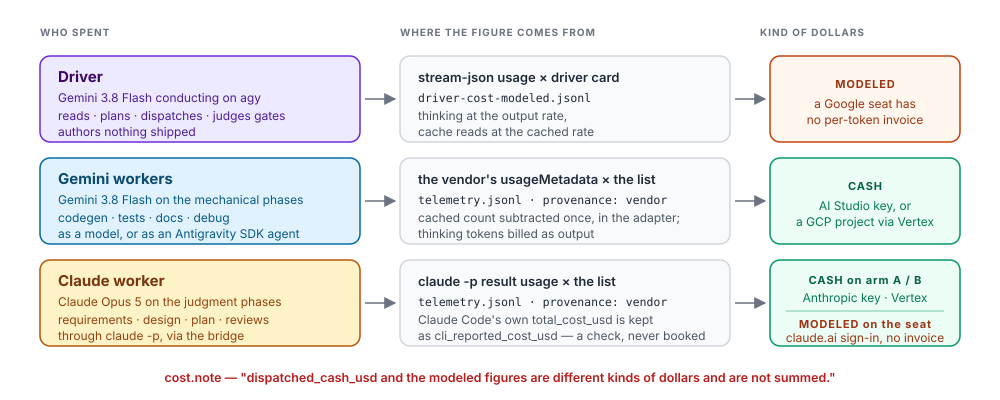
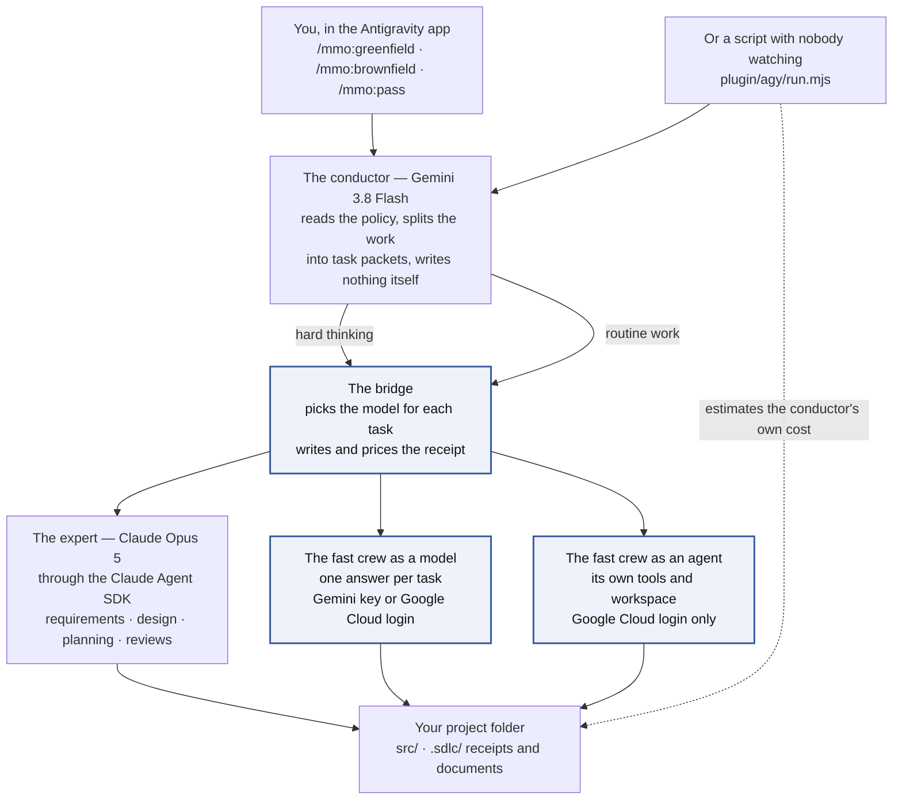

# AI-SDLC Orchestrator — Antigravity Harness

[](LICENSE)
[](https://github.com/tl-ai-labs/ai-sdlc-orchestrator-antigravity-harness/actions/workflows/test.yml)
[](plugin/plugin.json)


You describe the software you want in a short document, and a team of AI models plans it, writes it, tests it, reviews it, and hands you a bill that shows what each step cost.

**On this page:** [What this is](#what-this-is) · [What it can do](#what-it-can-do-for-you) · [What happens during a run](#what-happens-during-a-run) · [Which model does which step](#which-model-does-which-step) · [Before you start](#before-you-start) · [Setup](#setup--the-two-prompt-flow) · [Your first run](#your-first-run-step-by-step) · [What you get](#what-you-get-after-a-run) · [What it costs](#what-it-costs) · [Commands](#commands) · [If something goes wrong](#if-something-goes-wrong) · [How it works inside](#how-it-works-inside) · [Try it free](#try-it--one-offline-run) · [Install without the app](#install-without-the-app-clone-route) · [Where the project stands](#where-the-project-stands) · [Words you will see](#words-you-will-see)

## What this is

This repository is a **plugin** (an add-on) for Google's Antigravity app, whose command name is `agy`. It turns the app into a small software team. Think of a construction crew:

| On a building site | In this project | What it does |
|---|---|---|
| The client's wish list | The **brief** (a short text file, for example [examples/quick-demo/brief.md](examples/quick-demo/brief.md)) | Says what to build and what not to build |
| The site manager | **Gemini 3.8 Flash** inside the Antigravity app (the **conductor**) | Reads the brief, splits the job into small tasks, hands each task out, keeps the schedule. It never builds anything itself. |
| The senior architect | **Claude Opus 5** (made by Anthropic) | The careful, expensive expert: writes the requirements, draws the design, plans the tasks, reviews the finished code and checks it for security holes |
| The fast crew | **Gemini 3.8 Flash** (made by Google) | The quick, cheap worker: writes the code, the tests and the documentation for each small task |
| The front desk with the receipt book | The **bridge** (`plugin/mcp/model-dispatch`) | Every task passes through it. It sends the task to the right model, writes down how much work it took, and prices it. |
| Inspections | **Gates** | Points where the run stops and asks you "does this look right?" before it continues |
| The final invoice | The **cost report** | Shows what each step cost, from the receipts |

Why two kinds of model: the expert costs many times more per word than the fast crew. Sending only the hard thinking to the expert and the routine typing to the fast crew keeps the bill low.

Everything the run writes — code, documents, receipts — stays in your project folder. The only thing that leaves your computer is the text each model needs to do its task.

The same plugin also exists for two other apps: the [Claude Code version](https://github.com/tl-ai-labs/ai-sdlc-orchestrator-claude-code-harness) and the [Codex version](https://github.com/tl-ai-labs/ai-sdlc-orchestrator-codex-harness). This one is the Antigravity version.

## What it can do for you

There are two kinds of job. **Greenfield** means building something new in an empty folder. **Brownfield** means changing a project that already exists.

| You have… | You want… | Type this | Example of what to type |
|---|---|---|---|
| An empty folder and an idea | A brand-new small application | `/mmo:greenfield` | `/mmo:greenfield` (it asks you what to build) |
| An existing project | A bug fixed | `/mmo:bugfix` | `/mmo:bugfix the login page crashes when the password is empty` |
| An existing project | A new option on something that already exists | `/mmo:feature-extend` | `/mmo:feature-extend add a search box to the users page` |
| An existing project | A whole new part | `/mmo:feature-new` | `/mmo:feature-new add email notifications` |
| An existing project | Tests written | `/mmo:test` | `/mmo:test add tests for the payments code` |
| An existing project | Documentation written | `/mmo:docs` | `/mmo:docs write a README section for the settings page` |
| An existing project | Messy code tidied up without changing what it does | `/mmo:refactor` | `/mmo:refactor move the shared date code into one file` |
| An existing project | A library upgraded | `/mmo:deps` | `/mmo:deps upgrade jest from 28 to 29` |
| An existing project | Not sure which of the above | `/mmo:brownfield` | `/mmo:brownfield` followed by a sentence; it suggests the job type and you confirm |

On an existing project, you choose which files are off-limits before anything changes, and those files are never touched. `/mmo:revert` puts back every file a run changed. If you type `/mmo:greenfield` inside an existing project, it warns you and offers `/mmo:brownfield` instead. More on existing projects: [docs/brownfield.md](docs/brownfield.md).

## What happens during a run

```mermaid
flowchart LR
    A["1. You hand over<br/>the brief"] --> B["2. Expert writes<br/>requirements"]
    B --> G1{{"You approve"}}
    G1 --> C["3. Expert draws<br/>the design"]
    C --> G2{{"You approve"}}
    G2 --> D["4. Fast crew<br/>writes the code"]
    D --> E["5. Your computer<br/>runs the tests"]
    E --> F["6. Expert reviews<br/>and checks security"]
    F --> G3{{"You approve"}}
    G3 --> H["7. Report<br/>and bill"]
    H --> G4{{"You accept"}}
```



At each gate the run stops, shows you a file to read, and waits. You reply with one of three answers:

| You type | What happens |
|---|---|
| `approved` | The run continues to the next step |
| `revise: ` followed by your comments | The expert rewrites that step using your comments, then asks again |
| `abort` | The run stops. Nothing more is spent. |

| Gate | When | What you read |
|---|---|---|
| Gate 0 (existing projects only) | Before anything is written | What it found in your project, the files it plans to touch, and the files it must never touch |
| Gate 1 | After requirements | `requirements.md` — what the software must do |
| Gate 2 | After design | `design.md` — how it will be built (for an existing project: `change_plan.md` — what it will change) |
| Gate 3 | After the security check | `security_review.md` — problems found and how serious they are |
| Gate 4 | At the end | The summary and the bill |

A run with nobody watching (a **headless run**, started from a script) answers every gate automatically with `--gates=auto-approve` and writes each answer to `gates.jsonl`.

## Which model does which step

Each step of a run is called a **phase**. The default settings file, called a **policy** ([plugin/config/policies/antigravity-flash38-plus-opus5.yaml](plugin/config/policies/antigravity-flash38-plus-opus5.yaml)), decides who does each phase. You can change it with `/mmo:policy change`, which opens a settings page in your browser.

### Model per phase

| Step | Phase name in the files | Who does it |
|---|---|---|
| Check that every model is reachable and priced | `preflight_dispatch` | Your computer, no model |
| Read the brief | `read_brief` | The conductor |
| Look through your existing project (existing projects only) | `discovery` | The conductor, reading your files on your computer |
| Write the requirements | `requirements_analysis` | Claude Opus 5 |
| Draw the design | `architecture_design` | Claude Opus 5 |
| Plan the changes (existing projects only) | `change_plan` | Claude Opus 5 |
| Split the work into small tasks | `plan_task_packets` | Claude Opus 5 |
| Write the code, tests and documentation | `execute_packets` (`codegen`, `tests`, `docs`) | Gemini 3.8 Flash |
| Fix a task that failed twice | `debug` | Claude Opus 5, automatically |
| Run the tests | `test_run` | Your computer, no model |
| Review the code | `senior_code_review` | Claude Opus 5 |
| Check for security problems | `security_review` | Claude Opus 5 |
| Write the summary | `generate_final_report` | The conductor |

On an existing project, the work splits by job type:

| Job | Who plans | Who does the edits |
|---|---|---|
| `docs`, `test` | — | Gemini 3.8 Flash |
| `bugfix` | — | Gemini 3.8 Flash; Claude Opus 5 takes over after 2 failed tries |
| `feature-extend`, `feature-new`, `refactor`, `deps` | Claude Opus 5 | Gemini 3.8 Flash |

Two safety rules are always on:

- **No endless retries.** When the fast crew fails the same task twice, the third try goes to Claude Opus 5.
- **A $50 spending limit per run.** Before every task, the bridge adds up what the run has spent so far. Once that reaches $50 (the `hard_cost_cap_usd` setting), it refuses to start any more tasks and says why. You can raise, lower or remove the limit in your policy.

What the $50 limit does not stop:

| Case | Why |
|---|---|
| The task that crosses the limit | The check happens before a task starts, so that task finishes and the run ends a little over $50. Tasks already running also finish. |
| The conductor's own work | It is an estimate, not a charge, and is kept in a separate file (`driver-cost-modeled.jsonl`). |
| A single expert task | One Claude Opus 5 answer has no size limit of its own; see [docs/methodology.md](docs/methodology.md#output-ceiling-doubling). |
| A task that times out or is abandoned | A timed-out Claude Opus 5 task is recorded at $0, and one that is cut off leaves no receipt, so neither counts toward the limit. Both happened in the [greenfield audit](docs/verification/greenfield-001-cost-audit.md). |
| A task sent without a receipt file | The bridge has nothing to add up, so it neither checks nor counts that task. |

On a claude.ai subscription, the limit counts the estimated Claude cost too, so it limits real charges plus that estimate.

More detail: [docs/brownfield-routing.md](docs/brownfield-routing.md).

## Before you start

| Thing | What it is | Where it comes from |
|---|---|---|
| A Mac, Linux, or Windows with WSL2 | The computer it runs on | — |
| Node.js 22.19 or newer | A free program other tools need | [nodejs.org](https://nodejs.org) |
| The Antigravity app (`agy`, version 1.2.3 or newer), signed in with Google | The app you type into; the conductor lives here | Google Antigravity |
| Claude Code (`claude`) installed | The bridge uses it to reach Claude | [claude.com/claude-code](https://claude.com/claude-code) |
| One way to pay for Claude | An Anthropic API key (`ANTHROPIC_API_KEY`, called **arm A**), a Google Cloud project with Claude turned on (**arm B**), or a claude.ai subscription that Claude Code is signed in to (the **seat**) | Anthropic console, Google Cloud console, or claude.ai |
| One way to pay for Gemini | A Gemini API key (`GEMINI_API_KEY`), or a Google Cloud login (`gcloud auth application-default login`) | [aistudio.google.com](https://aistudio.google.com/app/apikey) or `gcloud` |
| Optional: Python 3.10 or newer | Only for the "Gemini as an agent" option, which also needs the Google Cloud login. The Python that ships with macOS (3.9) is too old. | [python.org](https://www.python.org) |

You don't need all the answers in advance. Setup checks each of these and tells you exactly what is missing. Every option, with how to check it: [docs/setup.md](docs/setup.md).

## Setup — the two-prompt flow

You set it up once per project folder by pasting one sentence. Then you start the work with a second message in a fresh session.

**Step 1 — open the Antigravity app in your project folder.** For a new app, make an empty folder first. In a terminal:

```bash
mkdir ~/my-first-app
```

```bash
cd ~/my-first-app && agy
```

For an existing project, run `agy` inside that project's folder instead.

**Prompt 1 — setup.** Paste this sentence exactly as it is:

```
Set up this plugin from this repo - https://github.com/tl-ai-labs/ai-sdlc-orchestrator-antigravity-harness, branch develop
```

What happens next, in order (the full list is in [INSTALL.md](INSTALL.md)):

1. The app downloads a copy of this project next to your folder and builds it.
2. It checks that `agy`, `claude` and your keys are present, and tells you what is missing.
3. If you have a Google Cloud login, it asks whether the fast crew should work as a plain model (one answer per task) or as an agent (with its own tools and workspace). Both cost the same per word; the default answer is fine.
4. It connects the plugin to your folder through a hidden `.agents/plugins/mmo/` folder. Nothing is written to your home folder's Antigravity settings (`~/.gemini/`).
5. A browser page opens once. Press **Save** to keep the default policy.

**Prompt 2 — run.** Start a **new `agy` session in the same folder**: quit the app, then open it again with `agy` in the same folder. Answer **yes** when it asks whether you trust the folder. Then type one command:

```
/mmo:greenfield      # empty folder: build a new app
/mmo:brownfield      # existing project: change it
```

Or use one of the job commands from [What it can do for you](#what-it-can-do-for-you). Type `/skills` to see every command, listed under `mmo:`.

> **Why a new session?** The app loads the plugin's commands only when a session starts, and only in a folder you trust. In the setup session the commands don't exist yet, so a run started there has no way to reach the models.

## Your first run, step by step

1. Type `/mmo:greenfield`.
2. It checks the setup again. If something is broken it stops here, before spending anything.
3. It asks what to build. Pick the **Ping Service** sample ([examples/quick-demo/brief.md](examples/quick-demo/brief.md)): it is small, takes minutes, and costs the least. To build your own idea instead, write a brief by following [docs/brief-template.md](docs/brief-template.md): a one-line summary, the business context, and what is in and out of scope.
4. It shows which model will do each step and asks you to confirm. Nothing is spent before you say yes.
5. Read the file at each gate and reply `approved`, `revise: ...`, or `abort`.
6. When it finishes, look at what you got (next section).

A longer walkthrough of each stage: [docs/tutorial-first-run.md](docs/tutorial-first-run.md). Other sample briefs: [examples/unit-convert/](examples/unit-convert/) (one endpoint, minutes to run), [examples/workforce-ops/](examples/workforce-ops/) (the large reference brief), [examples/travel-ops/](examples/travel-ops/) (booking, cancellation and refunds).

## What you get after a run

Your new code goes in `src/` (a new project) or stays where it is (an existing project). Everything else goes in the run's own folder inside your project's hidden `.sdlc/` folder: `.sdlc/runs/` followed by the run's name.

| File | What it is | When you need it |
|---|---|---|
| `requirements.md`, `design.md`, `security_review.md` | The expert's requirements, design and security review | To read what was decided and why |
| `SUMMARY.md` | A short summary of the run | First thing to read |
| `telemetry.jsonl` | The receipt book: one line per model call, with the step, the model, the words in and out, the price and the time taken | To check any single charge |
| `manifest.json` | Totals added up from the receipts, by step, by model and by payment line | Used by the cost report |
| `gates.jsonl` | Every gate answer | To see who approved what |
| `policy_snapshot.yaml`, `preflight.json` | The settings as they were when the run started, and the price check done before it | To repeat or audit a run |
| `provenance.json` | Every file the run changed, with a fingerprint of how it looked before (existing projects only) | `/mmo:revert` reads it to undo the run |
| `driver-cost-modeled.jsonl` with `driver-collector.json` (in the app), or with `driver-manifest.json`, `driver-events.jsonl` and `driver-stderr.log` (headless) | The conductor's own record | To see the conductor's estimated cost |
| `delegation/` | The fast crew's task notes and receipts, when it worked as an agent | To audit agent work |
| `.hook-logs/hook.jsonl` | A backup list of every bridge call (runs inside the app only) | Safe to delete |

To print the bill, open a terminal in the copy of this project that setup downloaded (setup tells you where it is) and run the report on the run's folder:

```bash
node tools/report.mjs ~/my-first-app/.sdlc/runs/<run-name>
```

`<run-name>` is the folder name under `.sdlc/runs/`; the run prints it when it starts.

To undo a run on an existing project, type `/mmo:revert` followed by the run's name, for example `/mmo:revert 20261006-142025-feature-new-maps-screen`. How to read every file in detail: [docs/understanding-output.md](docs/understanding-output.md).

## What it costs



The bill has separate lines that are **never added together**, because they are different kinds of money:

| Line | What it is | Is it a real charge? |
|---|---|---|
| Cash — Claude Opus 5 | The expert's work, metered by Anthropic or Google Cloud | Yes, on your Anthropic key or Google Cloud project |
| Cash — Gemini | The fast crew's work, metered by Google | Yes, on your Gemini key or Google Cloud project |
| Modeled — the conductor | An estimate of the site manager's work. Antigravity runs on a flat Google subscription with no per-task bill, so this line is a calculation, not an invoice. Inside the Antigravity app (the normal way), the run reads the conductor's work from the app's own record of the conversation on your computer at the end of the run. A headless run reads it from the app's output instead. | No. It shows what that work would cost if it were billed per use. |
| Modeled — Claude seat | Only when you use a claude.ai subscription instead of a key: the same kind of estimate for the expert | No, same reason |

How the receipts are written: every task passes through the bridge, and the bridge adds one line per model call to the run folder's `telemetry.jsonl` with the words sent, the words returned, and the price at the vendor's published rate. The cost report reads those lines. Nothing is guessed except the two "modeled" lines, which are clearly labelled. The full method: [docs/methodology.md](docs/methodology.md).

Read the bill with the cost report (`node tools/report.mjs`), not with `manifest.json`. Today the `total_cost_usd` field inside `manifest.json` adds the cash and modeled lines together, which mixes real charges with estimates.

What real runs have cost so far:

| Run | Cash | Modeled (Claude on a claude.ai seat) |
|---|---|---|
| A new app (5 Oct 2026) | $3.61 | $14.78 |
| A new screen in an existing mobile app (6–8 Oct 2026) | $0.13 | $20.24 |

## Commands

Fifteen skills (the Antigravity name for commands). Type them in an `agy` session; `/skills` lists them under `mmo:`. Thirteen are yours to type. The other two, `pipeline` and `brownfield-guide`, are the instruction manuals the others follow ([pipeline](plugin/skills/pipeline/SKILL.md), [brownfield-guide](plugin/skills/brownfield-guide/SKILL.md)); you never type them.

Every command that starts a run asks before it spends anything, and nothing starts a run unless you type it.

### Start a run

| Command | Use it when | What it does |
|---|---|---|
| [`/mmo:greenfield`](plugin/skills/greenfield/SKILL.md) | You have an empty folder and want a new app | Asks for a brief (or offers a sample), confirms where the code goes, shows which model does each step, then builds the app into `./src/`. Takes no extra words. |
| [`/mmo:brownfield`](plugin/skills/brownfield/SKILL.md) | You want to change an existing project | Looks through your project, asks what you want done, shows you the plan at Gate 0, then makes the change. Add a sentence to skip a question — `/mmo:brownfield add per-lane WIP limit to Board` — and it suggests the job type for you to confirm. |
| [`/mmo:pass`](plugin/skills/pass/SKILL.md) | You want to run without anyone watching (scripts, automated checks) | The same run with every answer given up front as a setting: `--auth=vendor` (the only value this version accepts), `--policy`, `--study`, `--run-id`, `--mode=greenfield\|brownfield`, `--intent`, `--gates`, and more. Every setting: [docs/running.md](docs/running.md). |

### Start a specific job on an existing project

Shortcuts for `/mmo:brownfield` with the job type already chosen. Add a sentence describing the job. Gate 0 still shows you the plan before anything changes.

| Command | Job | Example |
|---|---|---|
| [`/mmo:docs`](plugin/skills/docs/SKILL.md) | Write documentation | write API docs, README, ADRs, docstrings for the auth module |
| [`/mmo:bugfix`](plugin/skills/bugfix/SKILL.md) | Fix a bug | fix the /login endpoint returning 500 on missing password |
| [`/mmo:feature-extend`](plugin/skills/feature-extend/SKILL.md) | Add to something that exists | add a `?filter` param to the existing /users endpoint |
| [`/mmo:feature-new`](plugin/skills/feature-new/SKILL.md) | Add a new part | add a webhooks module (endpoint, storage, retry loop) |
| [`/mmo:refactor`](plugin/skills/refactor/SKILL.md) | Tidy code without changing behavior; runs every test to prove nothing broke | extract shared date logic into a util module and update all call sites |
| [`/mmo:test`](plugin/skills/test/SKILL.md) | Write tests | backfill unit tests for src/payments to reach 80% line coverage |
| [`/mmo:deps`](plugin/skills/deps/SKILL.md) | Upgrade a library | upgrade jest 28 → 29 (and adapt breaking changes) |

### Check or change the setup

| Command | Use it when | What it does |
|---|---|---|
| [`/mmo:setup`](plugin/skills/setup/SKILL.md) | You want to check that everything is installed, after you change a key, or after you update this project | Rebuilds the bridge and re-checks your keys. Opens a browser page only when you need to decide something. Safe to run any time. |
| [`/mmo:policy`](plugin/skills/policy/SKILL.md) | You want to see or change which model does which step, or the spending limit | On its own, shows the current settings for this project. `/mmo:policy change` opens the browser page to pick or edit settings. `/mmo:policy --policy=` followed by a name switches without the browser. The choice is saved per project in `.sdlc/project.json`. |

### Undo

| Command | Use it when | What it does |
|---|---|---|
| [`/mmo:revert <run-id>`](plugin/skills/revert/SKILL.md) | You want to undo a run on an existing project | Puts every file the run changed back the way it was. If you edited one of those files after the run, it stops and shows you the differences instead of overwriting your edit. Options: `--dry-run` (show what it would do), `--skip-dirty` (skip files you edited), `--keep-backups`. |

## If something goes wrong

| What you see | What to do |
|---|---|
| `/mmo:greenfield` is not recognized | You are still in the setup session, or you didn't trust the folder. Quit `agy`, open it again in the same folder, and answer **yes** to the trust question. |
| Setup says a key or program is missing | Install or add what it names, then type `/mmo:setup` to check again. |
| Things broke after you updated this project | Type `/mmo:setup`. It rebuilds the bridge, which is not stored in git and must be rebuilt after each update. |
| The run stops with a message about the cost cap | The $50 safety limit was reached. Type `/mmo:policy change` to raise it, or stop here. |
| You want to stop a run | Reply `abort` at the next gate. |
| Something else | [docs/troubleshooting.md](docs/troubleshooting.md) lists symptoms, causes and fixes. |

The same check works from a terminal, inside the downloaded copy of this project. The second command also checks what an existing project needs (git 2.30 or newer, a writable `.sdlc/` folder, no clashing command names):

```bash
npm run verify -- --fix
```

```bash
npm run verify -- --brownfield-check
```

## How it works inside



The highlighted path is where the money is saved: routine work goes to the cheaper model. Every piece of shipped work — requirements, design, code, tests, reviews — comes back through the bridge, so every piece has a receipt. That is also the main difference from the Claude Code version, where the expert works inside the session and its cost is counted afterwards from log files.

How the parts connect, for developers:

| Part | What it is |
|---|---|
| The conductor | `agy` itself, running Gemini 3.8 Flash at high effort on your Google account. It never writes shipped content. |
| The bridge | An MCP server (a small program the app talks to through a standard protocol) in [plugin/mcp/model-dispatch](plugin/mcp/model-dispatch). It routes each task, calls the model, and writes the receipt. |
| Expert route | Bridge → the `claude-agent-sdk` adapter → the Claude Agent SDK (`@anthropic-ai/claude-agent-sdk`) → Claude Opus 5, paid by arm A, arm B or the seat |
| Fast crew route | Bridge → `flash-completion` on `GEMINI_API_KEY`, or the Antigravity SDK worker on a Google Cloud login |
| Inside the app | The app loads the plugin's `mcp_config.json`, and the conductor calls the bridge directly |
| Headless | `agy -p` loads no plugin, so the conductor runs [plugin/agy/dispatch.mjs](plugin/agy/dispatch.mjs), which talks to the same bridge. Same five tools, same task format. |
| The receipts | The bridge writes `telemetry.jsonl`; [plugin/agy/manifest.mjs](plugin/agy/manifest.mjs) adds them up into `manifest.json`. A model never writes the totals. |

Only one policy ships: `antigravity-flash38-plus-opus5`, where Gemini 3.8 Flash conducts, Claude Opus 5 does the expert work, Gemini 3.8 Flash does the routine work, and the spending limit is $50. Its `driver:` section pins the conductor, and `run.mjs` checks that pin before anything is spent. The Claude Code version's other policies live under `plugin/mcp/model-dispatch/test/fixtures/policies/`, used only by tests.

The complete file list: [docs/architecture.md](docs/architecture.md#file-inventory).

## Try it — one offline run

This runs the whole chain with a stand-in for `agy` and made-up numbers: no sign-in, no keys, $0. Run it from a copy of this repository (see [Install without the app](#install-without-the-app-clone-route)):

```bash
mkdir -p /tmp/smoke && cp examples/quick-demo/brief.md /tmp/smoke/brief.md
npm run smoke -- --project-root=/tmp/smoke --run-id=smoke1
node tools/report.mjs /tmp/smoke/.sdlc/runs/smoke1
```

The stand-in ([tools/test/fixtures/fake-agy/](tools/test/fixtures/fake-agy/)) answers the way the real app does, runs twice so the resume step is tested, and makes one real $0 call through the bridge. It checks the plumbing, not the quality of real model output: every figure in that report is made up and labelled as such. The same run happens on every `npm test` ([tools/test/smoke-run.test.mjs](tools/test/smoke-run.test.mjs)).

## Install without the app (clone route)

To set up a project from a terminal instead of pasting the setup sentence:

```bash
git clone --branch develop https://github.com/tl-ai-labs/ai-sdlc-orchestrator-antigravity-harness.git
cd ai-sdlc-orchestrator-antigravity-harness
npm ci && npm run build && npm test
node tools/setup.mjs --project-root /path/to/your/project
```

`tools/setup.mjs` runs the same checks as the setup sentence, builds the bridge, connects the plugin to your project, and opens the policy page so you can review or change it.

| Option | Effect |
|---|---|
| `--yes` | Takes every default answer (the policy page still opens) |
| `--policy=` followed by a policy name | Picks that policy without opening the browser |
| `--no-agent` | Skips the "model or agent" question for the fast crew |

To start a headless run, try it first with `--dry-run`. That prints exactly what would run, showing each key only as "set" or "unset":

```bash
node plugin/agy/run.mjs --brief=examples/quick-demo/brief.md --project-root=/path/to/empty/dir --gates=auto-approve --dry-run
```

Every headless setting: [docs/running.md](docs/running.md).

## Where the project stands

| Question | Answer |
|---|---|
| Does the free practice run work? | Yes, on every `npm test` (see [Try it — one offline run](#try-it--one-offline-run)). |
| Has it run for real? | Yes, twice, both inside the Antigravity app — the two runs in [What it costs](#what-it-costs). Each has a line-by-line cost audit: [greenfield](docs/verification/greenfield-001-cost-audit.md), [brownfield](docs/verification/brownfield-maps-screen-cost-audit.md). |
| Were those bills right? | Each recorded price matches the vendor's published rate. Some calls were missing: a Claude call that timed out was booked at $0, and one that was cut off left no receipt. In the brownfield run, most coding tasks went to the expensive expert instead of the fast crew, because the policy did not name those task types. |
| Has a headless run been done for real? | Not yet. So the conductor's own cost has never been measured from real numbers. |
| Where are the published example runs? | None are in this repository yet; the first will be the [Ping Service](examples/quick-demo/) brief. The [Claude Code version](https://github.com/tl-ai-labs/ai-sdlc-orchestrator-claude-code-harness) ships two in `examples/quick-demo/passes/`. |

Every capability claim about the Antigravity app is backed by a numbered check in [docs/verification/p1-agy-runtime.md](docs/verification/p1-agy-runtime.md).

### This version and the Claude Code version

| | This repository (Antigravity) | [Claude Code version](https://github.com/tl-ai-labs/ai-sdlc-orchestrator-claude-code-harness) |
|---|---|---|
| Site manager | Gemini 3.8 Flash in the Antigravity app | Claude in Claude Code |
| Expert's work | Goes through the bridge, so every expert call has its own receipt | Done in the Claude Code session itself; counted afterwards from the session's log files |
| Site manager's own cost | Read from the app's own conversation record in the app, or from its output on a headless run | Counted after every run from Claude Code's log files |
| $50 safety limit | Enforced before each task | Written in the settings, not enforced |
| Which wallet paid | Written on every receipt | Not written |
| Published example runs | None yet | Two |

## Words you will see

| Word | Meaning |
|---|---|
| `agy` | The Antigravity app's command name |
| Plugin | An add-on that teaches Antigravity new commands; this repository is one, named `mmo` |
| Skill | Antigravity's name for a command such as `/mmo:greenfield` |
| Brief | The short document describing what to build |
| Greenfield / brownfield | Building something new / changing something that exists |
| Conductor (or driver) | The site manager: Gemini 3.8 Flash inside the Antigravity app |
| Bridge | The front desk every task passes through; it picks the model and writes the receipt |
| MCP | The standard protocol the app uses to talk to the bridge |
| Policy | A settings file that says which model does which step and sets the spending limit |
| Phase | One step of the run, such as "requirements" or "security review" |
| Gate | A stop where the run waits for your `approved`, `revise: ...`, or `abort` |
| Task packet | One small piece of work handed to a model |
| Telemetry | The receipt book: one line per model call, with words used and price |
| Manifest | The totals added up from the receipts |
| Token | The unit AI companies bill by; roughly three quarters of a word |
| Cash / modeled | A real charge on your account / an estimate of what unbilled work would cost |
| Seat | A flat monthly subscription (claude.ai, or the Google account Antigravity runs on) with no per-task bill |
| Arm A / Arm B | Paying for Claude with an Anthropic key (A) or through Google Cloud (B) |
| Headless run | A run with nobody watching, started from a script, that approves gates automatically |
| `.sdlc/` | The hidden folder in your project where every run keeps its documents and receipts |

## More documentation

| Document | Covers |
|---|---|
| [docs/setup.md](docs/setup.md) | Every way to pay for Claude and Gemini, and how to check each |
| [docs/running.md](docs/running.md) | Headless runs: every setting, resuming, the run folder |
| [docs/brief-template.md](docs/brief-template.md) | How to write a brief |
| [docs/tutorial-first-run.md](docs/tutorial-first-run.md) | A first run, stage by stage |
| [docs/understanding-output.md](docs/understanding-output.md) | Reading the report, the manifest and the raw files |
| [docs/methodology.md](docs/methodology.md) | How words and costs are counted; cash vs modeled |
| [docs/troubleshooting.md](docs/troubleshooting.md) | Symptom → cause → fix |
| [docs/architecture.md](docs/architecture.md) | Every part and every file |
| [docs/brownfield.md](docs/brownfield.md) | Working on existing projects, and Gate 0 |
| [docs/brownfield-write-contract.md](docs/brownfield-write-contract.md) | How off-limits files are protected |
| [docs/brownfield-coexistence.md](docs/brownfield-coexistence.md) | Using it alongside Cursor, Aider, Copilot and other tools |
| [docs/brownfield-privacy.md](docs/brownfield-privacy.md) | What data leaves your computer, private endpoints, regulated code |
| [docs/logging.md](docs/logging.md) | The `MMO:` log lines |
| [docs/verification/p1-agy-runtime.md](docs/verification/p1-agy-runtime.md) | The numbered checks behind every claim about the app |

The full index, grouped by what you are trying to do: [docs/README.md](docs/README.md).

## License

MIT — see [LICENSE](LICENSE).

---

<p align="center">
  <a href="https://tilicho.in">
    
  </a>
  <br />
  Built and maintained by <a href="https://tilicho.in">Tilicho</a>.
</p>
