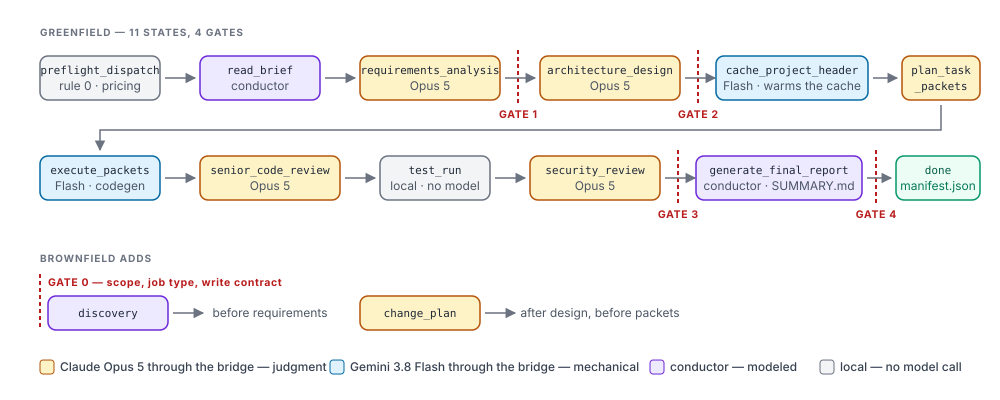

# Running the harness

> **For:** driving the harness — the interactive skills, every flag on the headless driver, the pin gate, the resume loop and what the run directory holds. **Also see:** [setup.md](setup.md) · [understanding-output.md](understanding-output.md) · [troubleshooting.md](troubleshooting.md).



Two shapes. Interactive is how you build and debug the plugin; headless is how a measured run is recorded.

## Interactive

Run `node tools/setup.mjs --project-root <project>` once (README, "Setup — the two-prompt flow"); it mounts the plugin as `<project>/.agents/plugins/mmo/`. Then open `agy` in the project — or in the repo root, where the committed mount already applies — and answer yes to the trust prompt. `/skills` lists `mmo:greenfield`, `mmo:brownfield`, `mmo:pass` and the rest; the bridge's tools are reached through `call_mcp_tool`. Invoke a skill, answer the gates by hand. Credentials come from the shell that launched `agy` (see [SETUP.md](../SETUP.md)).

## Headless

```bash
node plugin/agy/run.mjs \
  --brief=examples/quick-demo/brief.md \
  --project-root=/path/to/empty/dir \
  --policy=antigravity-flash38-plus-opus5 \
  --gates=auto-approve \
  --run-id=quick-demo-1 \
  --dry-run
```

`--dry-run` prints the invocation with the prompt truncated and every credential reported only as set/unset. Drop it to run.

| Flag | Default | Meaning |
|---|---|---|
| `--brief` | `<project-root>/brief.md` | The brief the conductor reads |
| `--project-root` | cwd | The application's repo; added to the agy workspace with `--add-dir` |
| `--output-dir` | `<project-root>/.sdlc/runs/<run-id>` | The run record, one folder per run. Added to the workspace when it is outside the project. A reused folder is safe for cost: the manifest, the report and the cost cap count only this run's lines, and a `SUMMARY.md` older than this run's start does not mark it complete |
| `--code-dir` | `<project-root>/src`; the project root with `--mode=brownfield` | Where the application is written |
| `--policy` | `.sdlc/project.json` → `default_policy`, else `antigravity-flash38-plus-opus5` | Policy name under `plugin/config/policies/`. A `<project-root>/routing-policy.yaml` wins over it, as it does in the bridge ([SETUP.md §5](../SETUP.md#5-choosing-the-policy)) |
| `--run-id` | timestamp | `pass_id` on every telemetry event, and the run's folder name. Letters, digits, `.`, `_`, `-` |
| `--gates` | required | `auto-approve` records `auto-approved` in `gates.jsonl` and continues; `auto-abort` stops at the first gate. `prompt` is refused: print mode has no one to answer, and the resume loop would carry the run past every gate unreviewed. Answer gates yourself in an interactive session instead |
| `--mode`, `--intent`, `--seed` | — | The brownfield handover the guide's step 4 reads. `--seed` without `--intent` on a brownfield run resolves the job type at launch through `plugin/scripts/infer-intent.mjs` and records `intent.source: "inferred"`; a seed that matches no job type, or several, refuses to launch and asks for `--intent` |
| `--resume=<conversation-id>` | — | Continue an earlier session instead of starting one |
| `--max-turns` | 12 | Cap on agy invocations per run |
| `--print-timeout` | `6h` | agy's own print-mode timeout; the default is 5 minutes |
| `--agy-bin` | `agy` | Path to the binary when it is not on PATH |
| `--inline-env` | off | Check-5 fallback: build a per-run root under the OS temp dir with credentials inlined into `mcp_config.json` |
| `--keep-run-root` | off | Keep that root after the run, for inspection |
| `--allow-unverified-pin` | off | Run while a pin check is pending (none is today); stamps `pin.verified: false`, `pin.unverified_reason: "pending_checks"` in the manifest |

### What the invocation pins

| argv | Why | Check |
|---|---|---|
| `--model gemini-3.8-flash-high` | The driver pin, slug derived from the policy's `driver:` block | 14 |
| `--dangerously-skip-permissions` | Print mode soft-denies every tool that would prompt | 6 |
| no `--sandbox` | The bridge is a piped subprocess | 2 |
| `--print-timeout 6h` | A pass runs hours | — |
| cwd = repo root | Where the plugin mount lives; print mode loads it anyway only in name — see below | 10 |
| `--add-dir <project>` | Mandatory; the workspace is otherwise the harness repo | — |

### The pin gate

`docs/verification/p1-agy-runtime.md` says nothing may be pinned on a pending check. `plugin/agy/telemetry/fairnessPin.mjs` lists the checks the headless pin depends on (2, 4, 6, 10); all four passed live on 2026-09-17, so `run.mjs` runs without `--allow-unverified-pin`. If a check is ever set back to pending, the gate closes again.

Passed checks open the gate; they do not prove the run held the pin. `pin.verified` is `true` only when agy itself named the model that conducted, and every name it gave is the pinned model or its slug:

| `pin.unverified_reason` | Meaning |
|---|---|
| `model_mismatch` | agy named a model that is not the pin (`driver_model_mismatch` lists it) |
| `pending_checks` | A check in `pin.pending_checks` is pending, and the run went ahead under `--allow-unverified-pin` |
| `no_model_observed` | Neither the stream nor agy's local conversation record named a model, so nothing shows which model conducted |

`pin.observed_models` lists the names read: the stream's (`driver_reported_models`) and, on a headless run, the `.1.19` field of agy's local conversation record (`driver_usage.local_record.models`). An interactive run reads them from `driver-collector.json`; without a collection its pin stays `no_model_observed`.

### Headless is plugin-less

`agy -p` loads no workspace customization: no plugin, MCP server, hook or skill (check 1). A headless run therefore has no `/mmo:*` skills and no bridge tools in the model's toolset; the conductor prompt `run.mjs` renders tells the model to dispatch through `plugin/agy/dispatch.mjs`, which speaks MCP to the bridge itself. The write-contract hook does not fire headless: a headless brownfield run has no guard, `harness.write_guard.state` says `off`, and the after-run check lists what the run changed outside its contract ([brownfield-write-contract.md](brownfield-write-contract.md#headless-runs)).

### The resume loop

One `agy --print` invocation may end before the pipeline does. `run.mjs` reads the `conversation_id` from the stream, and while `SUMMARY.md` is absent and agy exited 0, re-invokes with `--conversation <id>` and a short resume prompt, up to `--max-turns`. Every invocation's stream lands in `driver-events.jsonl`, in order, and `driver-manifest.json` → `driver_usage.invocations` records where each one starts and ends. agy's `usage` counters are cumulative within one process (check 8) and carry over into a resumed process on the same conversation (check 16, recorded on agy 1.3.0). The reader therefore differences each result against the one before, across processes, and a run with more than one invocation has one driver figure. `driver_usage.cost_usd_high` keeps the per-invocation reading beside it for comparison.

`--resume=<conversation-id>` into the same `--output-dir` keeps the earlier launch's invocations: `run.mjs` reads them back from the directory before it writes, so the driver line covers the whole conversation, not only the resumed part. The resume must use the policy and driver pin the conversation started under; `run.mjs` refuses otherwise. A resume that finds no earlier record in the directory is flagged `resumed_without_earlier_record`, because check 16 decides whether its first counters include the earlier launch.

## Measured runs: the greenfield and brownfield proof runs

Run cost is measured headless: `run.mjs` captures the conductor's own usage from agy's stream, every dispatch is priced at the bridge, and `manifest.json` carries the labelled lines. Each command below is copy-paste-runnable from the repo root.

**1. Before anything is spent.** All free.

| Step | Command | Pass when |
|---|---|---|
| Fresh build | `npm ci && npm run build` | No `bridge … older than its source` warning on later commands |
| Setup check | `npm run verify` | No blocking problem; Node 22.19+ |
| Offline suite | `npm test` | Every test passes |
| agy signed in | `agy models` | Lists `gemini-3.8-flash-high` |
| Stub run | the [offline smoke run](#offline-smoke-run) below | Report prints three cost lines |

Export one Claude wallet and the Gemini key in the shell you launch from. Arm A (`ANTHROPIC_API_KEY`) makes the Opus line cash on an Anthropic invoice, which is the line you can reconcile; the claude.ai seat makes it modeled.

```bash
export ANTHROPIC_API_KEY=...   # arm A
export GEMINI_API_KEY=...
```

**2. The greenfield run** — the Ping Service brief, one endpoint, every phase and gate:

```bash
mkdir -p /tmp/ping && cp examples/quick-demo/brief.md /tmp/ping/brief.md
node plugin/agy/run.mjs --project-root=/tmp/ping --run-id=ping-1 --gates=auto-approve --dry-run
node plugin/agy/dispatch.mjs --preflight --auth-mode=vendor --project-root=/tmp/ping --out=/tmp/ping-preflight.json; cat /tmp/ping-preflight.json
```

Read the dry run (policy, `policy_source`, driver price period, pin) and the preflight (`ok: true`, every model priced). Then, on an explicit go for the spend:

```bash
node plugin/agy/run.mjs --project-root=/tmp/ping --run-id=ping-1 --gates=auto-approve
node tools/report.mjs /tmp/ping/.sdlc/runs/ping-1
```

**3. The brownfield run** — the shipped bugfix example, in its own git project:

```bash
cp -R plugin/examples/brownfield-bugfix /tmp/bugfix
git -C /tmp/bugfix init -q && git -C /tmp/bugfix add -A && git -C /tmp/bugfix commit -qm baseline
node tools/setup.mjs --project-root=/tmp/bugfix --yes --no-agent --policy=antigravity-flash38-plus-opus5
node plugin/agy/run.mjs --project-root=/tmp/bugfix --mode=brownfield --intent=bugfix \
  --brief=/tmp/bugfix/intent_brief.md --run-id=bugfix-1 --gates=auto-approve
node tools/report.mjs /tmp/bugfix/.sdlc/runs/bugfix-1
```

A headless brownfield run has no write guard (print mode loads no hooks): read `harness.write_guard.after_run_check.outside_contract` in `manifest.json` and `git -C /tmp/bugfix diff` before you keep anything.

**4. Check the cost.** In each run's `manifest.json`:

| Field | What to check |
|---|---|
| `cost.lines[]` | Three lines, each with its `kind`. Never add a `modeled` figure to a `cash` one |
| `cost.lines[driver].basis` | Names the dated price period; a range means check 16 is still pending |
| `harness.driver_token_readings` | Every entry `cache-outside-total+thinking-in-output (adds_up)`. `not_recorded_layout` means agy changed how it reports its counters; anything else is booked at the dearest reading |
| `driver-manifest.json` → `driver_usage.local_record.agrees` | `true`: agy's local record and the stream agree on the driver's tokens |
| `harness.driver_model_mismatch` | Absent |
| `harness.bridge_build_stale` | Absent |
| `harness.other_runs_in_directory` | Absent |
| `completed` | `true`; `false` means re-run with the `--resume=` command `run.mjs` printed |

The Anthropic console (arm A) and the Gemini API billing page show the cash lines a day later; the run's `telemetry.jsonl` is the per-call ledger to reconcile against.

## Choosing a policy in the console

```bash
npm run console
```

Opens the policy console at http://127.0.0.1:3000 (`plugin/policy-console/`): a gallery of the shipped presets with the agy driver pin on each card, and an editor that customizes models, per-phase routing and thinking into a new saved policy under `plugin/config/policies/`. The `driver:` block and `hard_cost_cap_usd` are shown and carried into the saved file as-is; the pin is not a per-project choice. `plugin/scripts/setup-policy.mjs` runs the same page during setup and writes the chosen name to `.sdlc/project.json`.

## Offline smoke run

Before any paid run, drive the whole chain against the stub `agy` in `tools/test/fixtures/fake-agy/`. It speaks the recorded stream-json shapes, needs two invocations (so the resume loop runs), and makes one real $0 bridge call through the dispatch fallback:

```bash
mkdir -p /tmp/smoke && cp examples/quick-demo/brief.md /tmp/smoke/brief.md
npm run smoke -- --project-root=/tmp/smoke --run-id=smoke1
node tools/report.mjs /tmp/smoke/.sdlc/runs/smoke1
```

`tools/test/smoke-run.test.mjs` runs the same thing under `npm test`. Nothing the stub emits is a measurement; every figure is made up and labeled modeled.

## The run directory

| File | Written by | What |
|---|---|---|
| `policy_snapshot.yaml` | `run.mjs` at launch | The policy as it was when the run started |
| `skills/pipeline.md`, `skills/brownfield-guide.md` | `run.mjs` at launch | The playbook with real paths rendered in |
| `preflight.json` | the conductor, from `preflight_dispatch` | Rule 0's verdict |
| `telemetry.jsonl` | the bridge | Every dispatched call, vendor-metered |
| `gates.jsonl` | the conductor | One line per gate with the decision mode |
| `driver-events.jsonl` | `run.mjs` | The raw stream-json, every invocation |
| `driver-stderr.log` | `run.mjs` | agy's stderr, where soft-denials and hook notices land |
| `driver-cost-modeled.jsonl` | `run.mjs` | One `provenance: "modeled"` event per turn at the driver card |
| `driver-manifest.json` | `run.mjs` | The pin, exit status, invocations, completion, modeled driver cost and its `driver_usage` evidence (range, per-invocation counters, invocations that reported no usage), the mode and the job type with how it was chosen (`flag` or `inferred`) |
| `manifest.json` | `run.mjs` at the end, via `plugin/agy/manifest.mjs` | The code-written run record: the bridge's rollups plus `harness`, `usage` and `cost` with the three labeled lines. Rebuild any time with `node plugin/agy/manifest.mjs <dir>` |
| `SUMMARY.md` | the conductor | The completion signal |

`node tools/report.mjs <dir>` prints the cost report, keeping the modeled driver line apart from the cash lines.
