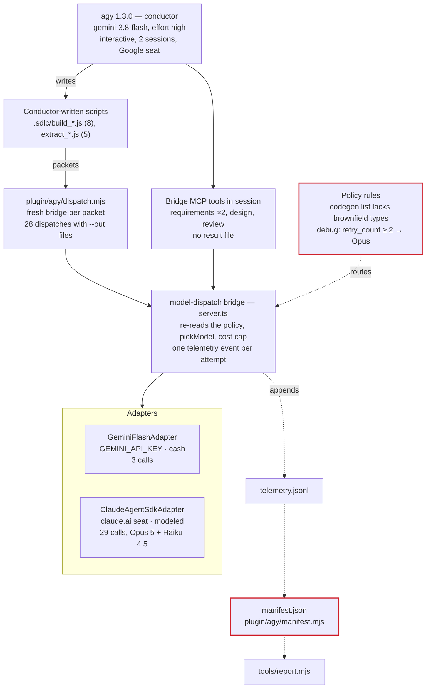

# Antigravity Harness Cost Audit — Brownfield Run `20261006-142025-feature-new-maps-screen`

Audit date 2026-10-08 · `test/cost-audit-fixes` at commit `698abc7` · run folder `~/Documents/mobile/.sdlc/runs/20261006-142025-feature-new-maps-screen/` (6 Oct 2026 08:52 UTC → 8 Oct 2026 04:48 UTC)

## Verdict

Every dollar the run booked re-derives from the raw tokens at the published rates, and the cost report keeps cash and modeled dollars apart. The money went somewhere the policy did not intend: $16.83 of the $20.24 Claude figure (83%) paid Opus for every codegen packet and a 13-dispatch debug loop on one test file, because the brownfield task types match no Flash rule and the debug packets inherited a retry count that sent them straight to the escalation rule. The manifest repeats the greenfield labelling defects, and two Opus timeouts booked $0.

| Question | Answer |
| --- | --- |
| Is driver cost calculated correctly? | Not calculated. Two interactive agy sessions (274.9 min on 6 Oct, 23.1 min on 8 Oct) expose no usage counters, so the driver line reads `NOT MEASURED`. |
| Is model (worker) cost calculated correctly? | Per call, yes. Gemini: 3 calls re-price to the booked $0.125141 exactly. Claude: 23 per-model ledgers plus 4 rows solved from telemetry give Opus $19.570082 + Haiku $0.666353 = the booked $20.236435. |
| Are the pinned rates right? | Yes. Opus 5, Haiku 4.5 and Gemini 3.8 Flash in `prices.ts` match the published cards. |
| Did routing follow the policy's intent? | No. All 10 codegen dispatches took the Opus default rule (`rule_index: -1`) because `existing_file_edit` and `new_file_add` are in no rule: $3.910089, against ≈ $0.44 at the Flash card. All 13 debug dispatches took the Opus escalation rule on their first attempt: $12.917158, 63.8% of the Claude line. |
| Is every dispatch in a figure? | All 32 dispatch starts closed, but two Opus codegen timeouts booked $0. Estimated unbooked spend: $0 to ≈ $2.34, modeled. |
| Is the reported total correct? | The report, yes: cash $0.1251 and modeled $20.2364, no total. The manifest, no: `total_cost_usd: 20.361576` is cash plus modeled. |
| Is the $50 cost cap enforced? | Yes, before each dispatch. The run ended at $20.36, seat-modeled dollars included. |
| What did you pay? | **$0.13 cash** on `GEMINI_API_KEY`. The $20.24 Claude figure is claude.ai seat quota priced at the API card. |
| Where could it have been cheaper? | Route brownfield codegen to Flash (−$3.47 modeled), stop paying 1-hour cache writes for single-shot prompts (−$3.60 to −$4.52), and break the debug loop: 7 of its 12 first-day iterations each mocked one more untranspiled ESM package ($6.13). |
| Do the tests pass? | 454 of 454. No policy test feeds a brownfield task type to the shipped policy, and `manifest.test.mjs:206` asserts the blended total. |

Audit scope: the run folder (`manifest.json`, `telemetry.jsonl`, `orchestrator.log`, 28 result files and their packets, `gates.jsonl`), the project's `.sdlc/local/` and `.sdlc/*.js`, the harness clone the run used (`~/Documents/ai-sdlc-orchestrator-antigravity-harness`, `698abc7` plus one uncommitted edit), every cost path in `plugin/mcp/model-dispatch/src` and `plugin/agy`, offline probes against the run folder, and the vendors' published price pages. No paid call was made.

## Architecture

The plugin mount `~/Documents/mobile/.agents/plugins/mmo/` symlinks into a second clone of this repo at `~/Documents/ai-sdlc-orchestrator-antigravity-harness`, on the same commit as this one. The conductor wrote 13 packet builders and result extractors into `~/Documents/mobile/.sdlc/` and dispatched through the bridge.

| Component | File | Cost role |
| --- | --- | --- |
| Pipeline skill | `plugin/skills/pipeline/SKILL.md` | Defines the brownfield task types (`:198-211`), debug-packet inheritance (`:237`) and the debug ladder (`:306`) |
| Policy | `plugin/config/policies/antigravity-flash38-plus-opus5.yaml` | Codegen rule (`:117-136` at `698abc7`), debug escalation (`:146-148`), Opus default (`:153`) |
| Dispatch client | `plugin/agy/dispatch.mjs`, `src/driverClient.ts` | One bridge per call (`dispatch.mjs:225-238`); 900 s tool timeout (`driverClient.ts:24`) |
| Bridge | `src/server.ts` | Routes with the packet's `retry_count` (`:416`), checks the cap (`:436-449`), writes one event per attempt (`:499-587`) |
| Claude adapter | `src/adapters/ClaudeAgentSdkAdapter.ts` | Starts the Agent SDK (`:116-133`); 300 s timeout at `698abc7`, 900 s in the run's clone |
| Claude ledger | `src/adapters/claudeCliLedger.ts` | Prices each model in `modelUsage` at its own rate |
| Manifest | `plugin/agy/manifest.mjs`, `src/telemetry.ts` | Totals, breakdowns, cost lines |
| Report | `tools/report.mjs` | Cost lines, no total |

## Model cast and how each model is started

| Role | Model (pin) | Adapter → class | How it is started | Credential | Cost source |
| --- | --- | --- | --- | --- | --- |
| Driver / conductor | `gemini-3.8-flash`, effort `high` | none | Interactive `agy` 1.3.0 in `~/Documents/mobile`, resumed on 8 Oct | Google sign-in seat | `NOT MEASURED` |
| Discovery | conductor, in session | none | Local read of the repo; one `provenance: "none"` row | — | $0 by design |
| Judgment worker and, here, codegen and debug | `claude-opus-5`, effort `high` | `claude-agent-sdk` → `ClaudeAgentSdkAdapter` | `query({ prompt, options: { model, maxTurns: 1, tools: [], settingSources: [], effort: "high", abortController } })`; no output cap; environment inherited | claude.ai seat (OAuth, `api_key_source: none`) | `modeled`: per-model ledger |
| SDK side call | `claude-haiku-4-5-20251001` | started by the SDK inside each Opus query | Same seat | `modeled`, booked under `claude-opus-5` |
| Mechanical worker | `gemini-3.8-flash`, thinking `LOW` | `mcp:model-dispatch` → `GeminiFlashAdapter` | `new GoogleGenAI({ apiKey })`, `generateContent` at temperature 0.2, ceiling 8,000 (packet budget) | `GEMINI_API_KEY` | `cash` |

## Driver cost

The conductor's tokens are in no figure. The pricing path for a headless run is the one described in [greenfield-001-cost-audit.md](greenfield-001-cost-audit.md#driver-cost); this run was interactive, so that path never ran.

| Item | 6 Oct session | 8 Oct session |
| --- | --- | --- |
| Window | 08:52:00 – 13:26:53 (274.9 min) | 04:25:43 – 04:48:50 (23.1 min) |
| Model-call time inside it | 65.1 min | 13.6 min |
| Conductor output | 9 packet builders and extractors, `requirements.md`, `change_plan.md` and its copy `design.md`, `senior_review_packet.json` (185 KB) | `build_refine_tests.js`, `build_security_packet.js`, `extract_*`, `SUMMARY.md`, `gates.jsonl` |
| Driver tokens, dollars | not measured | not measured |

The 39.0 hours between the sessions are idle; `duration_sec: 157978` counts them (finding 8).

## Model (worker) cost

The adapters price this run exactly as they priced the greenfield run; see [greenfield-001-cost-audit.md](greenfield-001-cost-audit.md#model-worker-cost) for the formulas and the adapter-by-adapter mapping. The checks against this run:

| Adapter | Run check | Result |
| --- | --- | --- |
| `GeminiFlashAdapter` | 3 calls, 78,155 fresh, 0 cached, 17,740 out → $0.125141 | Correct, exact |
| `ClaudeAgentSdkAdapter`, 23 dispatches with result files | `per_model` sum: Opus $17.945560 + Haiku $0.605322 | Correct |
| `ClaudeAgentSdkAdapter`, 4 dispatches without result files | Solved from the telemetry row, Opus fresh input 2 per call: Opus $1.624522 + Haiku $0.061031; Haiku output lands on whole 12–13 tokens, as on every packet with a ledger | Correct |
| `ClaudeAgentSdkAdapter`, 2 timeouts | `estimateTokens(prompt)` in, 0 out, $0 | Spend before the abort never booked (finding 3) |

### Worked example: `tp_tests_005_maps_screen_test_debug12`, one debug iteration

| Model | Bucket | Tokens | Rate (per 1M) | Cost |
| --- | --- | ---: | ---: | ---: |
| Opus 5 | Fresh input | 2 | $5.00 | $0.000010 |
| Opus 5 | Cache read | 0 | $0.50 | $0.000000 |
| Opus 5 | 1-hour cache write | 50,847 | $10.00 | $0.508470 |
| Opus 5 | Output (thinking included) | 23,276 | $25.00 | $0.581900 |
| Haiku 4.5 | Fresh input | 36,917 | $1.00 | $0.036917 |
| Haiku 4.5 | Output | 19 | $5.00 | $0.000095 |
| **Dispatch** | | | | **$1.127392** |

Six minutes earlier, `debug11` wrote a 49,727-token prompt for the same packet to the 1-hour cache. `debug12` read none of it.

### Pinned rates (USD per 1M tokens)

| Leaf | Pinned in `prices.ts` | Published, checked 2026-10-08 | Verdict |
| --- | --- | --- | --- |
| `claude-opus-5` | 5.00 / 6.25 5m write / 10.00 1h write / 0.50 read / 25.00 | 5 / 6.25 / 10 / 0.50 / 25 | Matches |
| `claude-haiku-4-5` | 1.00 / 1.25 / 2.00 / 0.10 / 5.00 | 1 / 1.25 / 2 / 0.10 / 5 | Matches |
| `gemini-3.8-flash`, to 2026-12-31 | 0.75 / 0.075 / 3.75 | 0.75 / 0.075 / 3.75 | Matches |
| `gemini-3.8-flash`, from 2027-01-01 | 1.50 / 0.15 / 7.50 | 1.50 / 0.15 / 7.50 | Matches |

### How the policy routed this run

| `rule_index` | Rule | Dispatches | Booked |
| --- | --- | ---: | ---: |
| 0–4 | Judgment phases → Opus | 6 | $3.409188 |
| 7 | `phase: tests` → Flash | 3 | $0.125141 |
| 9 | `phase: debug, retry_count ≥ 2` → Opus | 13 | $12.917158 |
| −1 | Default → Opus, "Unrecognized task — fail safe to premium" | 10 | $3.910089 |
| 6, 10 | Codegen list → Flash; `phase: debug` → Flash | 0 | — |

Neither Flash rule for code fired once. The three test-generation attempts ran `retry_count` 0, 1, 2; the first debug packet inherited 2 (`SKILL.md:237`) and every later one added 1, up to 14.

## This run's figures

| Line | Kind | Wallet | Dispatches | Booked |
| --- | --- | --- | --- | ---: |
| Gemini workers | cash | `GEMINI_API_KEY` | 3 | $0.125141 |
| Claude worker | modeled | claude.ai seat | 29 rows, 27 billed | $20.236435 |
| Claude, not booked | modeled, estimated | claude.ai seat | 2 timeouts | $0 – ≈ $2.34 |
| Driver | unmeasured | Google seat | — | — |

| Phase | Model | Calls | Booked | Kind |
| --- | --- | ---: | ---: | --- |
| Discovery | conductor, in session | 1 row | $0 | none |
| Requirements | Opus 5 | 2 | $0.417993 | modeled |
| Change plan (`architecture_design`) | Opus 5 | 1 | $0.161868 | modeled |
| Packet plan | Opus 5 | 1 | $0.574757 | modeled |
| Codegen, first pass | Opus 5 (default rule) | 6 (2 timed out) | $2.319934 | modeled |
| Tests | Flash | 3 | $0.125141 | cash |
| Debug, 6 Oct | Opus 5 (escalation rule) | 12 | $10.684058 | modeled |
| Senior review | Opus 5 | 1 | $1.105692 | modeled |
| Codegen, review refinements | Opus 5 (default rule) | 4 | $1.590155 | modeled |
| Debug, 8 Oct (test refinement) | Opus 5 (escalation rule) | 1 | $2.233100 | modeled |
| Security review | Opus 5 | 1 | $1.148878 | modeled |

| Claude bucket | Tokens | Cost | Share of the line |
| --- | ---: | ---: | ---: |
| Opus output | 397,153 | $9.928825 | 49.1% |
| Opus 1-hour cache writes | 960,971 | $9.609710 | 47.5% |
| Haiku 4.5 side calls | 664,093 in, 452 out | $0.666353 | 3.3% |
| Opus cache reads | 62,548 | $0.031274 | 0.2% |
| Opus fresh input | 54 | $0.000270 | 0.0% |

| Window (UTC) | Phase | Wall min | Model min |
| --- | --- | ---: | ---: |
| 6 Oct 09:00:59 – 09:17:52 | Requirements, change plan, packet plan | 16.9 | 6.5 |
| 6 Oct 10:18:55 – 10:51:58 | Codegen, first pass | 33.1 | 15.7 (10.1 of it in two timeouts) |
| 6 Oct 11:04:30 – 11:10:35 | Tests | 6.1 | 2.0 |
| 6 Oct 11:12:22 – 13:07:29 | Debug loop, 12 dispatches | 115.1 | 32.2 |
| 6 Oct 13:10:59 – 13:26:53 | Senior review, 4 refinements | 15.9 | 8.7 |
| 6 Oct 13:26:53 – 8 Oct 04:25:43 | Idle | 2,338.8 | 0 |
| 8 Oct 04:25:43 – 04:44:57 | Test refinement, security review | 19.2 | 13.6 |

## Correctness findings

| # | Severity | Finding | Evidence | Effect |
| --- | --- | --- | --- | --- |
| 1 | High | Brownfield codegen task types match no rule and fall to Opus | `SKILL.md:198-211` defines `new_file_add`, `existing_file_edit`, `patch_apply`, `bug_fix_apply`, `refactor_extract`, `dependency_add`; the codegen rule at `698abc7` lists none of them. `orchestrator.log`: 10 × `rule_index=-1`. This clone's working tree adds `existing_file_edit` only; the run's clone has neither | Every codegen packet ran on Opus: $3.910089 modeled. The same tokens at the Flash card: $0.436753 cash |
| 2 | High | The debug ladder never tries Flash and has no ceiling | Debug packets inherit `retry_count` (`SKILL.md:237`); the three test-generation attempts ended at 2, so the first debug packet matched rule 9 (`retry_count ≥ 2` → Opus). `SKILL.md:306` caps the cost-efficient attempts at 2 and sets no cap on premium ones; `retry_count` reached 14 | 13 Opus debug dispatches, $12.917158, 63.8% of the Claude line, on one test file. Rule 10 (debug → Flash) never fired |
| 3 | High | Two Opus timeouts billed the seat and booked $0 | `tp_codegen_002_maps_screen` and `_r1` hit `claude-agent-sdk timeout after 300s`; `failure()` records `cost_usd: 0` (`ClaudeAgentSdkAdapter.ts:318-330`). The conductor cut the retry's budget from 16,000 to 4,000, which the adapter does not apply, so the retry timed out the same way | $0 booked for 10.1 minutes of Opus generation; ≈ $2.34 if both generated at the next attempt's 105.9 tokens/s and wrote their prompts to the cache. No later cache read proves either way |
| 4 | High | `total_cost_usd` and every breakdown add cash and modeled dollars | `telemetry.ts:372-373`, `manifest.mjs:280-281`; `manifest.test.mjs:206` asserts the blend | $20.361576 = $0.125141 cash + $20.236435 modeled |
| 5 | Medium | The harness changed during the run, and no row can tell | The run's clone has one uncommitted edit: `DEFAULT_TIMEOUT_SEC` 300 → 900 and a `timeout_sec` override, written 10:38:05Z with `dist/` rebuilt at 10:37:56Z — between the second timeout (10:33:03Z) and the next attempt (10:39:10Z). Rows carry only `policy_version: 1` | Dispatches before and after 10:38Z ran under different timeouts with identical labels |
| 6 | Medium | Haiku 4.5 tokens, and two timeouts' estimates, sit in the `claude-opus-5` row | `model_breakdown` keyed by `ev.model` (`telemetry.ts:379`); ledger tokens summed across models; `per_model` not in telemetry | Of the row's 732,814 input tokens, 664,093 are Haiku, 68,667 are the timeouts' estimates and 54 are Opus. Opus's real prompt volume is 1,023,519 cache tokens, absent from `input_tokens` |
| 7 | Medium | Seat-billed Claude rows say `provenance: "vendor"` | `server.ts:529` | The report prints "32 vendor" beside a line it calls `modeled` |
| 8 | Medium | Duration counts 39 idle hours | `duration_sec = last ts − first ts` (`telemetry.ts:353-360`); no notion of sessions | `duration_sec: 157978`; the report prints "2632m 58s" for 298.0 minutes of sessions |
| 9 | Low | `gates` is null, and two gate times are in the wrong zone | `manifest.mjs:324` reads only `driver-manifest.json`. In `gates.jsonl`, gate 0 (`14:25:05.000Z`) and gate 1 (`14:35:32.000Z`) are IST wall times labelled UTC; gate 2 reads `09:09:32.201Z` | Gate evidence missing from the manifest; gates 0 and 1 appear 5.5 hours after gate 2, which they preceded |
| 10 | Low | `model_breakdown` carries a `"null"` model | The in-session discovery row has `model: null`; `cable.worker_models` lists `null` too | A consumer that sums by model name meets a `"null"` key |
| 11 | Low | Three replies the bridge could not use as asked | `tp_requirements_001` returned 205 Opus tokens and was re-dispatched; `tp_codegen_002_maps_screen_r3` returned `{"cmd": "Find trimbleLocationDataSelector"}` instead of a file and was redone as `_r4`; `tp_codegen_003_main_stack` came back as `raw` and the conductor parsed it with `extract_main_stack.js` | $0.194937 bought nothing used; the `raw` reply's $0.477821 was used only through a conductor-written parser |
| 12 | Low | `conductor_edits` is null | No `provenance.json` in the run folder | Whether the conductor changed worker output before writing it is unknown; `guard-decisions.jsonl` shows 71 allowed and 3 denied writes |
| 13 | Info | The driver line is `NOT MEASURED` | Interactive sessions | Correct label; 298.0 minutes of conductor sessions in no figure |
| 14 | Info | Opus output budgets are not applied, by design | `budget_enforced: false` on every Opus row | 397,605 output against 348,000 declared; `tp_tests_005_maps_screen_test_r3` wrote 63,411 against 16,000 |

### Spend findings

| # | Finding | Evidence | Recoverable on this run |
| --- | --- | --- | --- |
| S1 | The debug loop paid Opus once per missing mock | 12 iterations on 6 Oct, each fixing one failure in `__tests__/screens/MapsScreen.test.js`. Seven (`debug2`, `4`, `5`, `6`, `8`, `10`, `11`) fixed a `SyntaxError` from an untranspiled ESM package reached through `UserProfileScreen`'s imports (`lodash-es`, `uuid`, `react-native-create-thumbnail`, `@sentry/react-native`, `react-native-blob-util` and others) | $6.129378 for the seven; the same tokens for all 13 debug dispatches at the Flash card: $1.472586 |
| S2 | Codegen ran on Opus | Finding 1 | $3.47 modeled, for $0.44 cash |
| S3 | 1-hour cache writes that are never read | 960,971 write tokens at 2× input, 47.5% of the Claude line; reads 62,548. Debug iterations minutes apart read 0 or 2,643 tokens of each other's 38–51K prompts (one exception: 33,475) | $3.60 (5-minute writes) to $4.52 (no cache), modeled |
| S4 | Two timeouts and three unusable replies | Findings 3 and 11 | $0.19 booked, up to ≈ $2.34 unbooked |

### Verified correct

- Gemini fresh/cached split and thinking-in-output mapping; the 3 calls re-price exactly.
- Claude per-model pricing; Haiku at Haiku rates; 1-hour writes at 2× input; the SDK's own total agrees within $0.000003.
- Every rate in `prices.ts` that this run used matches the published card.
- The in-session discovery phase is recorded as a `provenance: "none"` row, so `unrecorded_phases: []` is right.
- The $50 cap is read before each dispatch.
- `manifest.json` is written by code, and rebuilding it reproduces every total, line and breakdown.
- `tools/report.mjs` knows `discovery` and `debug` as phases, keeps cash and modeled apart, and prints no total.
- The pre-check's "dispatch smoke" made no paid call: the bridge log shows preflight only.

## Test runs and probes

All runs used this clone at `698abc7` with the bridge built, on Node 25.6.1. No vendor API was called.

| Run | What it checks | Result |
| --- | --- | --- |
| `npm test` | Root and bridge suites | 454 / 454 pass |
| Probe: `buildHarnessManifest` on the run folder | Reproducible manifest | Identical totals, lines, timestamps and breakdowns, `"null"` key included |
| Probe: `node tools/report.mjs <run folder>` | Report lines | Cash $0.1251; claude modeled $20.2364; driver NOT MEASURED; "32 vendor, 1 none"; duration 2632m 58s |
| Probe: Gemini re-price | 3 calls | $0.125141, exact |
| Probe: `per_model` sum over 23 result files | Opus vs Haiku | Opus $17.945560 + Haiku $0.605322 |
| Probe: solve the 4 rows without result files | Haiku share | Opus $1.624522 + Haiku $0.061031; totals the booked $20.236435 |
| Probe: `rule_index` counts in `orchestrator.log` | Routing | −1 × 10, 9 × 13, 7 × 3, 0–4 × 6 |
| Probe: `dispatch.start` vs `dispatch.end` | Lost dispatches | 32 starts, 30 ends, 2 errors; none open |
| Probe: the run clone's `git diff` and mtimes | Mid-run edit | Timeout 300 → 900 s at 10:38:05Z, uncommitted |
| Probe: `.sdlc/local/debug.log` | Pre-check spend | Three preflights, no dispatch |

Why the suite misses them: the policy tests check greenfield task types against the shipped policy but none of the brownfield types in `SKILL.md:198-211`, no routing test follows `retry_count` from a tests packet into a debug packet, and the manifest test asserts the blended total.

## Recommendations

Fix findings 1 and 2 first: together they decided $16.83 of this run's $20.24.

- [ ] **Route the brownfield code types to Flash** (finding 1). Add `new_file_add`, `existing_file_edit`, `patch_apply`, `bug_fix_apply`, `refactor_extract` and `dependency_add` to the codegen rule in `antigravity-flash38-plus-opus5.yaml`. Test: every task type in `SKILL.md`'s brownfield table resolves to a named rule, not the default.
- [ ] **Reset the debug ladder and cap it** (finding 2). Start a debug packet at `retry_count: 0` when it follows a tests packet, so the first two debug attempts run on Flash; add a premium-attempt ceiling (for example 3) after which the conductor stops and asks you. Test: a tests packet at `retry_count: 2` followed by a debug packet routes the debug packet to Flash.
- [ ] **Give the debug packet the test environment** (S1). When failures repeat with the same error class (`SyntaxError` from `node_modules`), include `jest.config` and `transformIgnorePatterns` as packet inputs so one dispatch can fix the class rather than one package.
- [ ] **Book what a timed-out dispatch spent** (finding 3), as in the greenfield audit, and apply `budget.maxOutputTokens` to the Agent SDK if a cap is wanted, or stop the conductor from lowering a budget that has no effect.
- [ ] **Split `total_cost_usd`** (finding 4) and **label seat rows `modeled`** (finding 7), as in the greenfield audit.
- [ ] **Commit or revert the run clone's timeout edit** (finding 5), and stamp a policy hash and bridge build id on every event.
- [ ] **Book the SDK side call as its own model and drop the timeouts' estimates from token totals** (finding 6).
- [ ] **Measure duration per session** (finding 8): record session boundaries, or report active time beside wall time.
- [ ] **Write gate times from code** (finding 9) and read `gates.jsonl` into the manifest.
- [ ] **Key the discovery row by a model name** such as `in_session` instead of `null` (finding 10).
- [ ] **Measure the Opus cache trade** (S3): put the stable block in `systemPrompt` so repeat dispatches of one packet share a cached prefix.

## Sources

Opened 2026-10-08.

- [Anthropic API pricing](https://platform.claude.com/docs/en/about-claude/pricing): Opus 5 and Haiku 4.5 rates, cache-write multipliers
- [Gemini API pricing](https://ai.google.dev/gemini-api/docs/pricing): Gemini 3.8 Flash rates through 2026-12-31 and from 2027-01-01
- [greenfield-001-cost-audit.md](greenfield-001-cost-audit.md): adapter formulas, telemetry path, and the shared manifest and timeout findings
- Run folder: `manifest.json`, `telemetry.jsonl`, `orchestrator.log`, `*_result.json`, `gates.jsonl`; project `.sdlc/local/` and `.sdlc/*.js`
- Harness clone `~/Documents/ai-sdlc-orchestrator-antigravity-harness`: `git diff` and file mtimes
