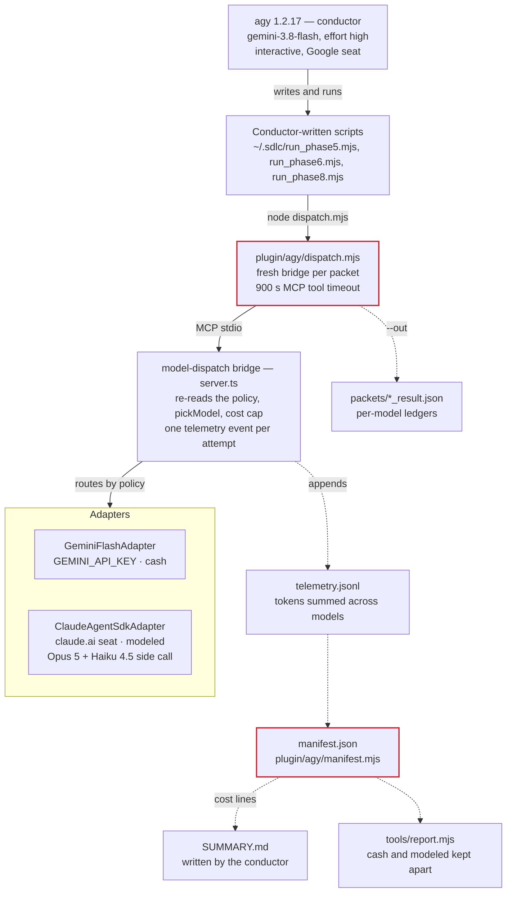

# Antigravity Harness Cost Audit — Greenfield Run `greenfield-001`

Audit date 2026-10-08 · `test/cost-audit-fixes` at commit `698abc7` · run folder `~/.sdlc/` (5 Oct 2026, 09:21–12:27 UTC)

## Verdict

Every dollar the run booked re-derives from the raw tokens at the published rates, and the cost report keeps cash and modeled dollars apart. The gaps are in what the run did not book and in how the manifest labels what it did: two Opus dispatches billed the seat and left $0 or no row, the manifest's top-level total adds cash to modeled dollars, Haiku 4.5 tokens sit under `claude-opus-5`, and the harness itself was edited while the run was in flight.

| Question | Answer |
| --- | --- |
| Is driver cost calculated correctly? | Not calculated. The conductor ran in an interactive agy session, which exposes no usage counters, so the driver line reads `NOT MEASURED` — the right label, and no figure. |
| Is model (worker) cost calculated correctly? | Per call, yes. Gemini: 275 attempts re-price to $3.610025 against $3.610045 booked. Claude: the 11 per-model ledgers sum to the booked $14.780407 exactly, and the SDK's own figure agrees within $0.000004. |
| Are the pinned rates right? | Yes. Opus 5, Haiku 4.5 and Gemini 3.8 Flash in `prices.ts` match the published cards, including the Flash step on 2027-01-01. |
| Is every dispatch in a figure? | No. A 300-second Opus timeout booked $0, and an abandoned Opus dispatch left no row at all. The second one provably wrote 87,409 cache tokens. Missing: ≈ $0.87 proven, up to ≈ $3.85 estimated, all modeled. |
| Is the reported total correct? | The report, yes: `tools/report.mjs` prints cash $3.6100 and modeled $14.7804 and no total. The manifest, no: `total_cost_usd: 18.390452` is cash plus modeled, and every breakdown mixes them the same way. |
| Is the $50 cost cap enforced? | Yes, before each dispatch (`server.ts:436`). It counts seat-modeled dollars too. The run ended at $18.39. |
| What did you pay? | **$3.61 cash** on `GEMINI_API_KEY`. The $14.78 Opus figure is claude.ai seat quota priced at the API card; no invoice exists. |
| Where could it have been cheaper? | 1-hour cache writes on single-shot prompts ($2.08–$2.16), Gemini replies truncated at 3,000 tokens and re-run ($1.10, 30% of the cash), one fix packet on the Opus default rule ($0.25). |
| Do the tests pass? | 454 of 454. None covers an abandoned dispatch, a timed-out dispatch's spend or a seat row's provenance, and `manifest.test.mjs:206` asserts the blended total. |

Audit scope: the run folder (`manifest.json`, `telemetry.jsonl`, `orchestrator.log`, 462 packet and result files, `gates.jsonl`, `local/debug.log`), every cost path in `plugin/mcp/model-dispatch/src` and `plugin/agy` at `698abc7`, offline probes against the run folder, and the vendors' published price pages. No paid call was made, so the $3.61 was not compared against the AI Studio invoice.

## Architecture

You drive an interactive agy session; the conductor dispatches every model call through the bridge and never calls a model API itself. In this run the conductor wrote its own phase scripts, which shell out to `dispatch.mjs`, which starts a fresh bridge for each packet.



Worker calls are priced inside the bridge, per attempt, and appended to `telemetry.jsonl`. The manifest and the report are both computed by `plugin/agy/manifest.mjs` from that file; the conductor copies the manifest's cost lines into `SUMMARY.md`. Nothing records the driver's tokens on an interactive run.

| Component | File | Cost role |
| --- | --- | --- |
| Dispatch client | `plugin/agy/dispatch.mjs`, `src/driverClient.ts` | Passes `policy_name`, `telemetry_path`, `work_dir`; one bridge process per call (`dispatch.mjs:225-238`); 900 s tool timeout (`driverClient.ts:24`) |
| Bridge | `src/server.ts` | Routes (`:411-421`), checks the cap (`:436-449`), writes one event per attempt (`:499-587`) |
| Gemini adapter | `src/adapters/GeminiFlashAdapter.ts` | Output-cap ladder (`:148`, `:169-269`), usage mapping (`:210-225`) |
| Claude adapter | `src/adapters/ClaudeAgentSdkAdapter.ts` | Starts the Agent SDK (`:116-133`, `:383-386`); 300 s timeout (`:53`) |
| Claude ledger | `src/adapters/claudeCliLedger.ts` | Prices each model in `modelUsage` at its own rate (`:396-666`) |
| Price list | `src/prices.ts` | Dated rates, verified 2026-09-14 |
| Cost cap | `src/runCostCap.ts` | Sums `cost_usd` in `telemetry.jsonl` before each dispatch |
| Manifest | `plugin/agy/manifest.mjs`, `src/telemetry.ts` | Totals, breakdowns, cost lines, harness block |
| Report | `tools/report.mjs` | Prints the manifest's cost lines with no total |

## Model cast and how each model is started

| Role | Model (pin) | Adapter → class | How it is started | Credential | Cost source |
| --- | --- | --- | --- | --- | --- |
| Driver / conductor | `gemini-3.8-flash`, effort `high` (policy `driver:` block) | none | Interactive `agy` in `~`; plugin found at `~/.agents/plugins/mmo/` (symlinks into this clone) | Google sign-in seat | `NOT MEASURED` (interactive); headless runs price agy's JSON usage as `modeled` |
| Judgment worker | `claude-opus-5`, effort `high` | `claude-agent-sdk` → `ClaudeAgentSdkAdapter` | `query({ prompt, options: { model, maxTurns: 1, tools: [], settingSources: [], effort: "high", abortController } })`; no `systemPrompt`, no output cap, environment inherited | claude.ai seat (OAuth, `api_key_source: none`), Claude Code 2.1.278 | `modeled`: per-model ledger from the result's `modelUsage` |
| SDK side call | `claude-haiku-4-5-20251001` | started by the SDK inside each Opus query | Same seat | `modeled`, booked under `claude-opus-5` |
| Mechanical worker | `gemini-3.8-flash`, thinking `LOW` | `mcp:model-dispatch` → `GeminiFlashAdapter` | `new GoogleGenAI({ apiKey })`, then `generateContent` at temperature 0.2 with `maxOutputTokens` = ceiling, a JSON response schema and `thinkingLevel: LOW` | `GEMINI_API_KEY` (AI Studio) | `cash` from `usageMetadata` |
| Not selected | `gemini-3.8-flash` agent worker | `antigravity-worker` | — | Vertex ADC | not used |

## Driver cost

The conductor's own tokens are in no figure. That is correct labelling, not a defect, but it leaves the largest session in the run unpriced.

### How it is computed

1. Headless only: `plugin/agy/run.mjs` captures agy's stdout (`:208-218`) and passes it to `plugin/agy/telemetry/event-reader.mjs`.
2. `extractTurnUsage` (`:74-96`) differences cumulative readings; fresh input is `input_tokens − cache_read_tokens`, output is `output_tokens + thinking_tokens`.
3. `modeledDriverCostEvents` (`:107-148`) prices each turn at the policy's `driver:` block ($0.75 / $0.075 / $3.75) and writes `driver-cost-modeled.jsonl`; resumed runs carry a low/high range (`driverRange.mjs`).
4. Interactive: there is no collector. `manifest.mjs:205-206` writes the `NOT MEASURED` line.

### What it means for this run

| Item | Value |
| --- | --- |
| Session, preflight → last dispatch | 185.7 min |
| Time inside model calls | 121.8 min, including 17.4 min in the abandoned dispatch |
| Conductor time and four human gates | 63.9 min |
| Conductor output | `run_phase5.mjs` (9 KB), `run_phase6.mjs` (11 KB), `run_phase8.mjs` (5 KB), `packets.json` (336 KB), `design.md` (byte copy of `architecture.md`), `SUMMARY.md`; 232 dispatches |
| Driver tokens, dollars | not measured |

The driver block's rates do not step on 2027-01-01, because headless pricing reads the policy block, not `prices.ts` (finding 13).

## Model (worker) cost

Every dispatched attempt is priced once, by the adapter, into disjoint token buckets. For Gemini:

```math
\text{cost} = \frac{\text{fresh}}{10^6} r_{in} + \frac{\text{cached}}{10^6} r_{cached} + \frac{\text{candidates} + \text{thoughts}}{10^6} r_{out}
```

For a Claude dispatch, each model in the SDK's `modelUsage` is priced at its own card and the rows are added:

```math
\text{cost} = \sum_{\text{model}} \frac{\text{fresh}}{10^6} r_{in} + \frac{\text{read}}{10^6} r_{read} + \frac{\text{write}_{5m}}{10^6} r_{w5m} + \frac{\text{write}_{1h}}{10^6} r_{w1h} + \frac{\text{output}}{10^6} r_{out}
```

| Adapter | Fresh input | Cached input | Output | Run check | Result |
| --- | --- | --- | --- | --- | --- |
| `GeminiFlashAdapter` | `promptTokenCount − cachedContentTokenCount` (`:220`) | `cachedContentTokenCount` | `candidatesTokenCount + thoughtsTokenCount` (`geminiTransports.ts:91-93`) | 275 attempts → $3.610025 vs $3.610045 | Correct |
| `ClaudeAgentSdkAdapter`, Opus row | `inputTokens` | `cacheReadInputTokens` | `outputTokens` (thinking included) | 11 rows → $14.439680; card re-price $14.439676 | Correct |
| `ClaudeAgentSdkAdapter`, Haiku row | `inputTokens` | — | `outputTokens` | 11 rows → $0.340727 at $1 / $5 | Correct, booked under Opus (finding 4) |
| `ClaudeAgentSdkAdapter`, timeout | `estimateTokens(prompt)` | 0 | 0 | 1 row, $0 | Spend before the abort never booked (finding 1) |

### Worked example: `tp_plan_001`, the run's most expensive dispatch

| Model | Bucket | Tokens | Rate (per 1M) | Cost |
| --- | --- | ---: | ---: | ---: |
| Opus 5 | Fresh input | 4 | $5.00 | $0.000020 |
| Opus 5 | Cache read | 87,409 | $0.50 | $0.043705 |
| Opus 5 | 1-hour cache write | 146,186 | $10.00 | $1.461860 |
| Opus 5 | Output (thinking included) | 121,680 | $25.00 | $3.042000 |
| Haiku 4.5 | Fresh input | 59,814 | $1.00 | $0.059814 |
| Haiku 4.5 | Output | 17 | $5.00 | $0.000085 |
| **Dispatch** | | | | **$4.607484** |

The telemetry row for this dispatch reads `input_tokens: 59818`, which is Haiku's 59,814 plus Opus's 4. The 87,409-token cache read came from the abandoned first attempt at the same packet (finding 1).

### Pinned rates (USD per 1M tokens)

| Leaf | Pinned in `prices.ts` | Published, checked 2026-10-08 | Verdict |
| --- | --- | --- | --- |
| `claude-opus-5` (`:150`) | 5.00 in / 6.25 5m write / 10.00 1h write / 0.50 read / 25.00 out | 5 / 6.25 / 10 / 0.50 / 25 | Matches |
| `claude-haiku-4-5` (`:161`) | 1.00 / 1.25 / 2.00 / 0.10 / 5.00 | 1 / 1.25 / 2 / 0.10 / 5 | Matches |
| `gemini-3.8-flash` (`:179-182`), to 2026-12-31 | 0.75 in / 0.075 cached / 3.75 out | 0.75 / 0.075 / 3.75, thinking billed as output | Matches |
| `gemini-3.8-flash`, from 2027-01-01 | 1.50 / 0.15 / 7.50 | 1.50 / 0.15 / 7.50 | Matches; the same tokens cost $7.220051 on this card |
| Driver block, policy YAML | 0.75 / 0.075 / 3.75 | — | Matches today; does not step in 2027 (finding 13) |

### How a call becomes telemetry

1. `dispatch.mjs` starts a bridge and calls `execute_with_model` with the packet, `policy_name` and `telemetry_path`.
2. The bridge re-reads the policy from disk and routes with `pickModel`, feeding it the packet's `retry_count` (`server.ts:416`).
3. `checkRunCostCap` sums `cost_usd` over the telemetry file and refuses the call at $50 (`server.ts:436-449`).
4. The adapter runs. Gemini re-sends a truncated reply at a doubled ceiling, at most 3,000 → 6,000 → 8,192 here; every attempt is billed.
5. After the adapter returns, the bridge appends one event per attempt, all stamped with the same `ts` (`server.ts:514`) and `provenance: "vendor"` (`:529`). Claude events carry the token sum across models; `per_model` stays only in `dispatch.mjs`'s `--out` file.
6. `manifest.mjs` builds `manifest.json` from the telemetry file; the conductor copies its cost lines into `SUMMARY.md`.
7. If the client times out first, the bridge is killed and steps 5 and 6 never see the call.

## This run's figures

| Line | Kind | Wallet | Dispatches | Booked |
| --- | --- | --- | --- | ---: |
| Gemini workers | cash | `GEMINI_API_KEY` | 219 packets, 275 attempts | $3.610045 |
| Claude worker | modeled | claude.ai seat | 12 rows, 11 billed | $14.780407 |
| Claude, not booked | modeled, estimated | claude.ai seat | 2 | ≈ $0.87 – $3.85 |
| Driver | unmeasured | Google seat | — | — |

| Phase | Model | Calls | Booked | Kind |
| --- | --- | ---: | ---: | --- |
| Requirements | Opus 5 | 2 (1 timed out) | $0.769948 | modeled |
| Architecture | Opus 5 | 1 | $1.832239 | modeled |
| Packet plan | Opus 5 | 1 (+1 abandoned) | $4.607484 | modeled |
| Codegen | Flash | 176 attempts | $1.781287 | cash |
| Codegen, `existing_file_edit` | Opus 5 | 1 | $0.279530 | modeled |
| Tests | Flash | 91 attempts | $1.698215 | cash |
| Docs | Flash | 8 attempts | $0.130543 | cash |
| Senior review | Opus 5 | 6 | $6.113909 | modeled |
| Security review | Opus 5 | 1 | $1.177297 | modeled |

| Claude bucket | Tokens | Cost | Share of the line |
| --- | ---: | ---: | ---: |
| Opus output | 352,523 | $8.813075 | 59.6% |
| Opus 1-hour cache writes | 555,811 | $5.558110 | 37.6% |
| Haiku 4.5 side calls | 339,932 in, 159 out | $0.340727 | 2.3% |
| Opus cache reads | 136,742 | $0.068371 | 0.5% |
| Opus fresh input | 24 | $0.000120 | 0.0% |

| Gemini bucket | Tokens | Cost | Share of the line |
| --- | ---: | ---: | ---: |
| Output | 581,068 | $2.179005 | 60.4% |
| Fresh input | 1,874,267 | $1.405700 | 38.9% |
| Cached input | 337,602 | $0.025320 | 0.7% |

## Correctness findings

| # | Severity | Finding | Evidence | Effect |
| --- | --- | --- | --- | --- |
| 1 | High | Two Opus dispatches billed the seat and booked $0 or nothing | `tp_requirements_01` hit the 300 s timeout; `failure()` records `cost_usd: 0` with estimated input (`ClaudeAgentSdkAdapter.ts:186-192`, `:318-330`). The first `tp_plan_001` start (10:10:34Z) has no end and no log line. The only path that writes nothing is the 900 s client timeout: the bridge ignores the MCP cancel (`server.ts:389`), the client kills it, and no event or `--out` file is written. The re-dispatch read 87,409 cached tokens no other call wrote | ≈ $0.87 proven (the cache write), up to ≈ $3.85 if both calls generated at their retries' rate until cut off. The SDK's Claude subprocess may outlive the killed bridge (inferred from SDK code, not tested) |
| 2 | High | `total_cost_usd` and every breakdown add cash and modeled dollars | `telemetry.ts:372-373` sums every event's `cost_usd`; `manifest.mjs:280-281` uses it. `cost.note` in the same file says the kinds "are not summed". `manifest.test.mjs:206` asserts the blended figure | $18.390452 = $3.610045 cash + $14.780407 modeled. `phase_breakdown.codegen` shows $2.060817 = $1.781287 cash + $0.279530 modeled |
| 3 | High | The harness and policy changed during the run, and no row can tell | Three files in this clone were rewritten mid-run and are still uncommitted: the policy (last write 12:18:20Z), the Claude adapter (timeout 300 → 1,800 s), `driverClient.ts` (900 → 1,800 s at 10:26:52Z). `env_docs` routed to Flash at 11:27:23Z though the committed policy lacks it; `existing_file_edit` hit the default rule at 12:17:25Z. Rows carry only `policy_version: 1` (`server.ts:535-536`); the bridge re-reads the YAML per dispatch | Routing and timeouts differ between rows that claim the same policy. Raising the adapter timeout above the 900 s client timeout is what turned the first plan dispatch into a silent kill (finding 1) |
| 4 | Medium | Haiku 4.5 tokens and dollars are booked under `claude-opus-5` | `model_breakdown` is keyed by `ev.model` (`telemetry.ts:379`); the ledger's top-level tokens sum every model (`claudeCliLedger.ts:504-509`); `per_model` is not copied into telemetry (`server.ts:546-584`) | 339,932 of the "Opus" row's 341,763 input tokens and $0.340727 of its cost are Haiku. The report prints 341.8K input for a line whose Opus prompts total 692,577 tokens |
| 5 | Medium | Seat-billed Claude rows say `provenance: "vendor"` | `server.ts:529` stamps every event `vendor` | `tools/report.mjs` prints "287 vendor" and "V vendor-metered" beside a line it calls `modeled` |
| 6 | Medium | `started_at` is the first event's end time | Events are stamped after the adapter returns (`server.ts:514`); `telemetry.ts:353-360` takes the first `ts` | Manifest and report start at 09:32:10Z; the first dispatch began 09:27:08Z and preflight ran 09:21:25Z. `duration_sec` is short by 302 s (dispatch window) and 645 s (session) |
| 7 | Low | `gates` is null with four approvals on file | `manifest.mjs:324` reads only `driver-manifest.json`; nothing reads `gates.jsonl` | Gate evidence missing from the manifest of every interactive run |
| 8 | Low | `conductor_edits` is null | `conductorWork.mjs` needs `provenance.json`; the run left none | Whether the conductor changed generated files after a worker returned them is unknown |
| 9 | Low | `retry_reason: "output_cap"` lands on the attempt after the capped one | `server.ts:567` sets it from `attempt_number > 1` | The 56 truncated attempts carry `success: false` and no reason; the successful retries carry the reason |
| 10 | Low | Pass id differs between manifest and telemetry | Manifest `greenfield-001`; all 287 rows `pass1` | Joining files by pass id fails |
| 11 | Info | The driver line is `NOT MEASURED` | Interactive session; no collector for agy | Correct label; the conductor's 185.7-minute session is in no figure |
| 12 | Info | Opus output budgets are not applied, by design | `agentSdkOptions` sets no output cap (`ClaudeAgentSdkAdapter.ts:111-115`); rows carry `budget_enforced: false`. The policy's `max_output_tokens_absolute: 32000` is read only by `BuiltinAnthropicAdapter` | 352,523 output against 89,000 declared (4.0×); the plan dispatch wrote 121,680 |
| 13 | Low | Driver rates will not follow the 2027 Flash price | Headless driver pricing reads the policy `driver:` block (`fairnessPin.mjs:62`), not `prices.ts` | A headless run after 2026-12-31 prices the driver at half the published rate |
| 14 | Info | Gemini thinking tokens read 0 on every row | `output_reasoning = thoughtsTokenCount ?? 0` (`GeminiFlashAdapter.ts:224`) | Booked output would include thoughts if the API reported them; 273 rows report none at `thinkingLevel: LOW` |

### Spend findings

| # | Finding | Evidence | Recoverable on this run |
| --- | --- | --- | --- |
| S1 | Every Opus prompt is written to the 1-hour cache and almost never read | 555,811 write tokens at 2× input; reads 136,742, of which 87,409 came from the abandoned plan dispatch. The adapter sends one concatenated prompt and sets no cache option | $2.08 (5-minute writes) to $2.16 (no cache), modeled |
| S2 | 30% of the Gemini cash went to truncated replies | 56 attempts hit the 3,000-token first ceiling (tests: 40 of 91 attempts). Each truncated reply is billed in full and re-sent | Up to $1.097544 cash by starting test packets at 8,192 |
| S3 | `existing_file_edit` fell through to the Opus default | `rule_index: -1` at 12:17:25Z | $0.25 modeled ($0.279530 on Opus, $0.033468 at the Flash card) |
| S4 | Opus output runs past every declared budget | Finding 12 | 263,897 tokens above budget, $6.60; not recoverable without a quality trade-off |
| S5 | The senior review's findings were mostly not applied | 6 reviews, $6.113909, 111 findings (29 blocker), 27 refinement packets; 1 dispatched; Phase 7 (`test_run`) never ran | — |

### Verified correct

- Gemini fresh/cached split subtracts the cached subset; thinking tokens are added to output; 275 attempts re-price within $0.00002.
- Claude per-model pricing: each `modelUsage` row is priced at its own card, Haiku at Haiku rates, 1-hour writes at 2× input; the ledger matches the SDK's `total_cost_usd` within $0.000004.
- Every rate in `prices.ts` that this run used matches the published card, including the dated Gemini step.
- The output-cap ladder bills and emits every attempt under one `task_id`, capped at the policy's 8,192 absolute.
- The $50 cap is read before each dispatch and refuses the call before any vendor request.
- `manifest.json` is written by code, and rebuilding it from the run folder reproduces every total, line and breakdown.
- `tools/report.mjs` keeps cash, modeled and unmeasured lines apart and prints no blended total.
- `unrecorded_phases: []` is right: all five judgment phases have rows.
- The driver line says `NOT MEASURED`, never $0 spend.

## Test runs and probes

All runs used this clone at `698abc7` with the bridge built, on Node 25.6.1. No vendor API was called.

| Run | What it checks | Result |
| --- | --- | --- |
| `npm test` | Root and bridge suites | 454 / 454 pass |
| Probe: `buildHarnessManifest` on `~/.sdlc` | Is the manifest code-written and reproducible? | Identical totals, lines, timestamps, breakdowns; `gates` and `conductor_edits` null again |
| Probe: `node tools/report.mjs ~/.sdlc` | Report lines | Cash $3.6100; claude modeled $14.7804; driver NOT MEASURED; "287 vendor" |
| Probe: Gemini re-price at $0.75 / $0.075 / $3.75 | 275 attempts | $3.610025 vs $3.610045 booked |
| Probe: sum of `per_model` in `packets/*_result.json` | Opus vs Haiku | Opus $14.439680 + Haiku $0.340727 = $14.780407 |
| Probe: Opus card on the Opus rows | 24 / 136,742 / 555,811 / 352,523 | $14.439676 |
| Probe: Opus card on the telemetry rows | Shows the Haiku fold | $16.152346, $1.37 over the booked figure |
| Probe: `dispatch.start` vs `dispatch.end` in `orchestrator.log` | Lost dispatches | 232 starts, 231 closed; `tp_plan_001` open from 10:10:34Z |
| Probe: committed vs working-tree policy | Mid-run routing change | `env_docs` matches no rule at `698abc7`, matched rule 6 at 11:27:23Z |
| Probe: file mtimes vs run window | Mid-run edits | Three source files written between 10:26:52Z and 12:18:20Z |

Why the suite misses them: no adapter test streams usage and then times out, no dispatch test lets the client time out before the adapter, no telemetry test checks `provenance` on a seat row, and the manifest test asserts the blended total as expected.

## Recommendations

Fix findings 1, 2 and 3 before quoting a Claude figure from an interactive run.

- [ ] **Book what a timed-out or abandoned dispatch spent** (finding 1). In `ClaudeAgentSdkAdapter`, price the frames the `ModelWriteAccumulator` holds when the timer fires instead of recording $0; in `server.ts:389`, honour the MCP cancel by aborting the adapter and writing that event; refuse to start when the adapter timeout is not below the client tool timeout. Test: a stub SDK that streams two assistant frames, then hangs past the timeout.
- [ ] **Split `total_cost_usd`** (finding 2). In `telemetry.ts` `buildManifest`, emit `total_cash_usd` and `total_modeled_usd` and the same pair per phase, model, module and task type; drop the blended field. Update `manifest.test.mjs:206` to expect the split.
- [ ] **Commit or revert the three mid-run edits, and stamp the policy hash** (finding 3). Put the timeout and routing changes on their own branch with tests; add `policy_sha256` and the bridge build id to every event in `server.ts:535`.
- [ ] **Book the SDK side call as its own model** (finding 4). Copy `per_model` into the telemetry event and key `model_breakdown` by the billed model.
- [ ] **Label seat rows `modeled`** (finding 5) at `server.ts:529`, from the wallet the adapter already stamps.
- [ ] **Record each attempt's start time** (finding 6) and take `started_at` from the first start.
- [ ] **Read `gates.jsonl`** when no driver manifest exists (finding 7).
- [ ] **Put `retry_reason` on the capped attempt** (finding 9) in `server.ts:567`.
- [ ] **Start Flash test packets at 8,192** (S2): the first ceiling is `min(packet budget, absolute)`, so raise `budget.maxOutputTokens` for `test_unit` and `test_integration` packets in the planner prompt.
- [ ] **Route fix and edit task types to Flash** (S3): the working-tree policy adds `existing_file_edit` and eight more; add `new_file_add` as well.
- [ ] **Measure the Opus cache trade** (S1): try `systemPrompt` for the stable block, as the adapter's header comment suggests, and compare one phase's dollars before switching.
- [ ] **Run the next greenfield pass headless** through `plugin/agy/run.mjs` so the driver line carries a figure (finding 11), and read driver rates from `prices.ts` (finding 13).

## Sources

Opened 2026-10-08.

- [Anthropic API pricing](https://platform.claude.com/docs/en/about-claude/pricing): Opus 5 and Haiku 4.5 rates, 5-minute (1.25×) and 1-hour (2×) cache-write multipliers
- [Gemini API pricing](https://ai.google.dev/gemini-api/docs/pricing): Gemini 3.8 Flash introductory rates through 2026-12-31 and the 2027-01-01 rates; thinking tokens billed as output
- `node_modules/@modelcontextprotocol/sdk` 1.30.0, `dist/esm/client/stdio.js:143-178`: client `close()` ends stdin, then SIGTERM, then SIGKILL
- Run folder `~/.sdlc/`: `manifest.json`, `telemetry.jsonl`, `orchestrator.log`, `packets/`, `gates.jsonl`, `local/debug.log`
